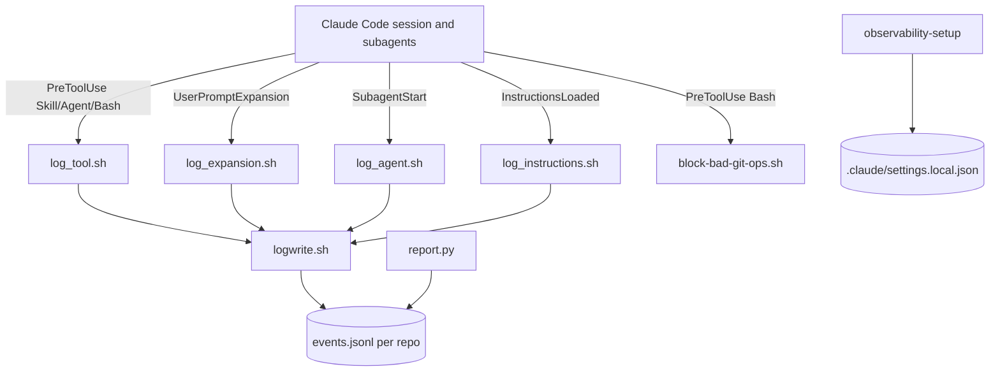
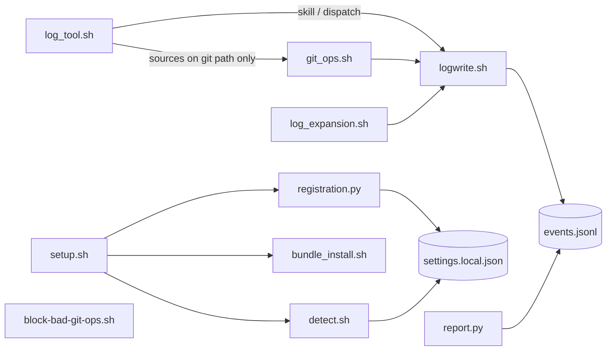
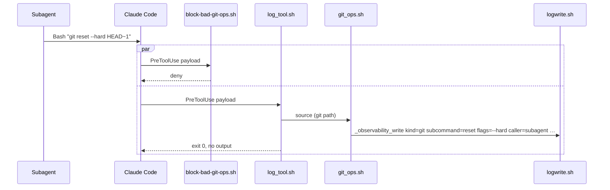

# Solution Design Document

## Validation Checklist

### CRITICAL GATES (Must Pass)

- [x] All required sections are complete
- [x] No [NEEDS CLARIFICATION] markers remain
- [x] Architecture pattern is clearly stated with rationale
- [x] **All architecture decisions confirmed by user**
- [x] Every interface has specification

### QUALITY CHECKS (Should Pass)

- [x] All context sources are listed with relevance ratings
- [x] Project commands are discovered from actual project files
- [x] Constraints → Strategy → Design → Implementation path is logical
- [x] Every component in diagram has directory mapping
- [x] Error handling covers all error types
- [x] Quality requirements are specific and measurable
- [x] Component names consistent across diagrams
- [x] A developer could implement from this design
- [x] Implementation examples use actual schema column names (not pseudocode), verified against migration files
- [x] Complex queries include traced walkthroughs with example data showing how the logic evaluates

---

## Output Schema

### SDD Status Report

| Field | Value |
|---|---|
| specId | 021-observability-v2 |
| architecture | Hook adapters writing to the existing per-repo JSONL record (018/019), extended by two adapters, one sourced classifier and report/registration changes |
| validationPassed | spec validation 2026-10-11: 0 FAIL, all WARNs addressed (README Decisions Log) |
| nextSteps | Implementation (Incremental, plan/) |

### ArchitectureSummary

| Field | Value |
|---|---|
| pattern | Adapter-per-event over a shared fail-open writer; registration by path namespace |
| keyComponents | `log_tool.sh`, `git_ops.sh`, `log_expansion.sh`, `logwrite.sh`, `registration.py` + `detect.sh`, `setup.sh`, `report.py`, `block-bad-git-ops.sh` |
| externalIntegrations | Claude Code hook events `PreToolUse` (matcher `Skill\|Agent\|Bash`) and `UserPromptExpansion` |

### SectionStatus

| Section | Status | Detail |
|---|---|---|
| Constraints | COMPLETE | |
| Implementation Context | COMPLETE | |
| Solution Strategy | COMPLETE | |
| Building Block View | COMPLETE | |
| Runtime View | COMPLETE | |
| Deployment View | COMPLETE | |
| Cross-Cutting Concepts | COMPLETE | |
| Architecture Decisions | COMPLETE | 9 ADRs, all confirmed 2026-10-11 |
| Quality Requirements | COMPLETE | |
| Acceptance Criteria | COMPLETE | |
| Risks and Technical Debt | COMPLETE | |
| Glossary | COMPLETE | |

### ADRStatus

| ADR | Name | Status |
|---|---|---|
| ADR-1 | One PreToolUse entry with matcher `Skill\|Agent\|Bash` and a dispatching `log_tool.sh` | CONFIRMED |
| ADR-2 | Git parsing copied into the bundle from `pattern_match.sh`, held equal by a parity test | CONFIRMED |
| ADR-3 | Short flags recorded as their first letter only | CONFIRMED |
| ADR-4 | New files owner-only at creation; setup tightens existing ones | CONFIRMED |
| ADR-5 | Drift judged per repository from its own registration, new state `OURS-INCOMPLETE` | CONFIRMED |
| ADR-6 | `log_tool.sh` and the guard use `#!/bin/bash`; `log_tool.sh` reads with `$(cat)` and exits on a substring test (supersedes 018 CON-2 for these two files) | CONFIRMED (revised 2026-10-11) |
| ADR-7 | Typed skills via `UserPromptExpansion`, recorded as `kind: skill`, `route: typed`; the report's inventory join decides what counts | CONFIRMED |
| ADR-8 | New `kind: dispatch`; the report credits a named agent through it and does not double count | CONFIRMED |
| ADR-9 | New `kind: git` carrying names only, scoped by a closed read-only list | CONFIRMED |

---

## Constraints

Inherited unchanged from 018 and 019 unless stated:

- **CON-1 — bash 3.2 and BSD userland** (018 CON-1). No `declare -A`, `mapfile`, `${var^^}`, PCRE in
  `[[ =~ ]]`, `EPOCHREALTIME`.
- **CON-2 — interpreter line** (018 CON-2, **superseded for `log_tool.sh` and the guard by ADR-6**). Every other
  script keeps `#!/usr/bin/env bash`.
- **CON-3 — `LC_ALL=C`** before formatting or arithmetic (018 CON-3; `logwrite.sh` exports it).
- **CON-4 — the hook protocol is load-bearing** (018 CON-4). No stdout, no stderr, exit 0 from every
  adapter. Exit 2 would block the tool call.
- **CON-5 — fail open, always** (018 CON-5, 019 CON-2).
- **CON-6 — no new runtime dependency** (018 CON-6, 019 CON-3). No `jq` in any hook path.
- **CON-7 — hook-path cost** (018 CON-7, **restated**). 018's ≤ 1 ms was never met on macOS and cannot
  be: a registered hook costs 3–5 ms per matching event whether or not it records (019 CON-5). This
  spec budgets: non-git `Bash` calls ≤ 5 ms added at p50 on macOS; a git record ≤ 30 ms added over the
  non-git path (revised 2026-10-12: `git rev-parse` alone costs ~12 ms through the macOS xcrun shim, and the
  hook runs in parallel with the guard, which takes longer); `Skill`,
  `Agent` and `UserPromptExpansion` stay within the existing adapter cost (~13–30 ms).
- **CON-8 — repo-local, opt-in** (018 CON-8, 019 ADR-1). Registration only in the target's untracked
  `.claude/settings.local.json`.
- **CON-9 — payload drift degrades to "records nothing"** (018 CON-9). The fields used here were
  measured on Claude Code 2.1.296 and are not versioned in the docs.
- **CON-10 — bytes, not necessarily UTF-8** (018 CON-10).
- **CON-11 — the instrument must not observe itself** (018 CON-11, **re-derived** for the new events
  below).
- **CON-12 — no cross-plugin `source`.** The bundle runs from `$HOME/.claude/observability/` without
  `CLAUDE_PLUGIN_ROOT` and installs independently of tcs-git-helpers ("mirror the contract, not the
  code", `observability-setup/lib/drift_check.sh:18-25`).
- **CON-13 — names, never values.** No flag value, positional argument, assignment value, URL,
  message, path, prompt or argument text reaches a `git`, `dispatch` or typed-`skill` record in any
  mode (PRD F1, F2, F3; README Decisions Log 2026-10-11).

**CON-11 re-derived.** `PreToolUse` fires for the session's and subagents' tool calls, not for hook
processes. No adapter issues a tool call. The git path parses text; its one `git rev-parse` (the
repo toplevel, resolved once and passed to the writer) runs as a hook subprocess, which raises no
hook event. So the instrument cannot generate a `Bash` tool call. `UserPromptExpansion` fires on a typed
command; no hook types one. The property still holds by construction.

## Implementation Context

### Required Context Sources

#### Documentation Context
```yaml
- doc: docs/XDD/specs/021-observability-v2/requirements.md
  relevance: CRITICAL
  why: "The approved PRD; every AC below traces to it"
- doc: docs/XDD/specs/021-observability-v2/README.md
  relevance: CRITICAL
  why: "Measured payloads on 2.1.296 and the decisions this design implements"
- doc: docs/XDD/specs/021-observability-v2/research.md
  relevance: HIGH
  why: "Technical, security and performance findings with file:line citations"
- doc: docs/XDD/specs/018-observability-load-and-fire-log/solution.md
  relevance: HIGH
  why: "Record schema (frozen field order), keep/drop rules and the `detail:` mechanism (§ Complex Logic), ADR-1..8, CON-1..11"
- doc: docs/XDD/specs/019-observability-rollout-across-active-repos/solution.md
  relevance: HIGH
  why: "Registration in settings.local.json (ADR-1), bundle versioning (ADR-3), namespace ownership (ADR-5), per-repo report (ADR-7/8)"
- doc: plugins/tcs-helper/scripts/observability/README.md
  relevance: MEDIUM
  why: "User-facing wording of the coverage caveats (:211-218) that changes with F4"
- url: https://code.claude.com/docs/en/hooks
  relevance: MEDIUM
  why: "Event list and matcher semantics; omits Agent `tool_input.name`, which the probe found"
```

#### Code Context
```yaml
- file: plugins/tcs-helper/scripts/observability/logwrite.sh
  relevance: CRITICAL
  why: "_observability_write (:601), _observability_field (:448), deny list (:557), mkdir (:643)"
- file: plugins/tcs-helper/scripts/observability/log_skill.sh
  relevance: HIGH
  why: "Adapter template: relative source, field extraction, exit 0 — but not its `read -d ''` (ADR-6)"
- file: plugins/tcs-helper/scripts/observability/log_agent.sh
  relevance: MEDIUM
  why: "SubagentStart adapter whose agent_type carries the spawn name interactively"
- file: plugins/tcs-helper/skills/observability-setup/lib/registration.py
  relevance: CRITICAL
  why: "REGISTRATION (:101-105), add_registration (:294-319), LEGACY_SCRIPTS (:406-410)"
- file: plugins/tcs-helper/skills/observability-setup/lib/detect.sh
  relevance: CRITICAL
  why: "OUR_EVENTS (:222), LEGACY_SCRIPTS copy (:236), OURS-CURRENT/OURS-OLD (:467-488)"
- file: plugins/tcs-helper/skills/observability-setup/lib/setup.sh
  relevance: HIGH
  why: "install/remove/status verbs, _REGISTERED_EVENTS display (:719)"
- file: plugins/tcs-helper/skills/observability-setup/lib/bundle_install.sh
  relevance: HIGH
  why: "_BUNDLE_INSTALL_SCRIPTS (:118)"
- file: plugins/tcs-helper/templates/observability/tcs-helper-observability-version
  relevance: HIGH
  why: "Bundle marker h1 → h2; CI gate check-hook-bundle-version.sh row 2"
- file: scripts/observability/report.py
  relevance: CRITICAL
  why: "fired_names (:1006), firing_coverage (:1074), build_load_report (:1561)"
- file: plugins/tcs-git-helpers/scripts/lib/pattern_match.sh
  relevance: HIGH
  why: "Source of the copied clause logic: _strip_quoted (:385), _strip_heredocs (:462), _clausify (:516), _is_git_token (:228)"
- file: plugins/tcs-git-helpers/scripts/lib/override.sh
  relevance: MEDIUM
  why: "_scan_tool_input_for_override (:79-97): first-token rule the override position mirrors"
- file: plugins/tcs-git-helpers/scripts/block-bad-git-ops.sh
  relevance: HIGH
  why: "F7 fast path goes right after INPUT=$(cat), before the two jq calls (:57-61); shebang → /bin/bash"
```

#### External APIs
```yaml
- service: Claude Code hooks (2.1.296, measured 2026-10-11)
  doc: README § Context
  relevance: CRITICAL
  why: "PreToolUse payload: tool_name, tool_input, tool_use_id, session_id, agent_id/agent_type inside a subagent; UserPromptExpansion: expansion_type, command_name (qualified for plugins), command_args, command_source"
```

### Implementation Boundaries

- **Must Preserve:** every existing record kind and its fields; the frozen prefix `ts, kind, session,
  repo`; `log_skill.sh`, `log_agent.sh`, `log_instructions.sh` behaviour (old registrations keep
  pointing at them until setup re-runs); namespace ownership (019 ADR-5); the guard's deny decisions.
- **Can Modify:** the PreToolUse registration entry (matcher and script), `detect.sh` states,
  `report.py` coverage and sections, the deny list, file creation modes, the guard's entry.
- **Must Not Touch:** what the tcs-git-helpers guard blocks; `overrides.jsonl`; any shared
  `.claude/settings.json`.

### External Interfaces

#### System Context Diagram



#### Interface Specifications

```yaml
inbound:
  - name: "PreToolUse (matcher Skill|Agent|Bash)"
    type: hook stdin JSON
    data_flow: "tool_name, tool_input{skill | subagent_type,name,description,prompt | command}, tool_use_id, session_id, agent_id?, agent_type?"
  - name: "UserPromptExpansion (matcher all)"
    type: hook stdin JSON
    data_flow: "expansion_type, command_name, command_args, command_source, prompt, session_id"
data:
  - name: "events.jsonl"
    type: append-only JSONL, rotated .1-.3 at 1,024,000 bytes
    data_flow: "one record per line; new kinds dispatch and git; skill gains route"
  - name: ".claude/settings.local.json"
    type: JSON, untracked
    data_flow: "hook registration written by setup"
```

### Cross-Component Boundaries

- **Contracts that cannot break:** the record prefix and every existing field; the settings entries
  of old registrations (they must keep running against the h2 bundle).
- **Shared resources:** `events.jsonl` (all adapters, append-only); `$HOME/.claude/observability/`
  (global bundle, shared by every registered repo).
- **Breaking change policy:** none planned. Old skill records without `route` read as `tool`.

### Project Commands

```bash
Test (python): pytest -q                                  # tests/ incl. tests/tcs-helper/
Test (bats):   bats --recursive plugins/*/tests/bats      # CI: tests.yml, TAP plan checked
Lint:          shellcheck <changed .sh files>
Gates:         bash plugins/tcs-git-helpers/scripts/ci/check-hook-bundle-version.sh origin/main..HEAD
               bash scripts/ci/check-docs-sync.sh --changed-files <file> --pr-body <file>
               bash scripts/ci/check-changelog-version-sync.sh --allow-ahead 1
Perf (opt-in): pytest -m perf -q ; bats perf cases scale by TCS_PERF_SLACK
```

## Solution Strategy

- **Architecture pattern:** adapter per hook event over the shared fail-open writer, as in 018. The
  three PreToolUse concerns share one adapter because one registration entry is the cheapest correct
  shape (ADR-1); the git logic sits in a separate file that only the git path sources (ADR-2, CON-7).
- **Integration approach:** setup's existing `update` path rewrites the PreToolUse entry and adds a
  UserPromptExpansion entry; old registrations keep working against the new bundle until then. The
  report gains a kind mapping and one section.
- **Justification:** every blocker found in research is answered without redesigning the
  registration model: one entry per event still holds, so `add_registration`'s replace-at-first-
  position logic and the cross-file pairing stay valid.
- **Key decisions:** ADR-1..9.

## Building Block View

### Components



| Component | Owns | PRD |
|---|---|---|
| `log_tool.sh` (NEW) | PreToolUse dispatch by `tool_name`; the non-git fast path; skill records with `route: tool`; dispatch records; git records (one write per line `git_ops.sh` prints) | F1 (tool route), F2, F3 (records) |
| `git_ops.sh` (NEW) | Pure parser, no writing, no `git` calls: JSON string decoding of `tool_input.command`; clause stripping (copied); git invocation parsing; read-only predicate; action, flag and override names | F3 (parsing) |
| `log_expansion.sh` (NEW) | Typed skill records (`route: typed`, `args_present`, `source`); reads with `$(cat)` (the expansion payload carries the expanded prompt and can be large, ADR-6) | F1 (typed route) |
| `logwrite.sh` (MODIFY) | Owner-only creation; deny list additions | F6 (new files, `args`) |
| `registration.py` + `detect.sh` (MODIFY) | Expected registration; per-repo completeness state `OURS-INCOMPLETE` | F5 |
| `setup.sh` (MODIFY) | Parsing the new state (`:601` label list, `:617-618` `IS_OURS`); tightening existing record files and directories on install; status wording; `_REGISTERED_EVENTS` | F5, F6 (existing files) |
| `bundle_install.sh` + marker (MODIFY) | Shipping the two new scripts; `h1` → `h2` | F5 |
| `report.py` (MODIFY) | Normalised firings (`firing_events`), route counts, dispatch dedupe, built-in agent list, legacy caveat, git section; single- and multi-source paths | F4, F1 AC 1.5 |
| `block-bad-git-ops.sh` (MODIFY, tcs-git-helpers) | Non-git fast path | F7 |

F8 (Could) has no owner in this phase: typed custom commands produce `kind: skill` records that
match no inventory entry, and the report lists them as not in the inventory (ADR-7). Giving them
their own kind is deferred.

### Directory Map

**Component**: tcs-helper observability bundle
```
plugins/tcs-helper/
├── scripts/observability/
│   ├── log_tool.sh            # NEW: PreToolUse Skill|Agent|Bash adapter (ADR-1, ADR-6)
│   ├── git_ops.sh             # NEW: git path, sourced by log_tool.sh only (ADR-2, ADR-3, ADR-9)
│   ├── log_expansion.sh       # NEW: UserPromptExpansion adapter (ADR-7)
│   ├── logwrite.sh            # MODIFY: umask on creation (ADR-4); deny list += args command_args description tool_input
│   ├── log_skill.sh           # UNCHANGED: still serves pre-h2 registrations
│   ├── log_agent.sh           # UNCHANGED
│   └── README.md              # MODIFY: new kinds, routes, coverage wording, git section
├── skills/observability-setup/
│   ├── SKILL.md               # MODIFY: registered events, OURS-INCOMPLETE, re-run after update
│   └── lib/
│       ├── registration.py    # MODIFY: REGISTRATION PreToolUse → ('Skill|Agent|Bash','log_tool.sh'); += UserPromptExpansion
│       ├── detect.sh          # MODIFY: OUR_EVENTS += UserPromptExpansion; EXPECTED copy; OURS-INCOMPLETE (ADR-5)
│       ├── setup.sh           # MODIFY: tighten modes on install (ADR-4); status text; _REGISTERED_EVENTS
│       └── bundle_install.sh  # MODIFY: _BUNDLE_INSTALL_SCRIPTS += log_tool.sh git_ops.sh log_expansion.sh
├── templates/observability/tcs-helper-observability-version   # MODIFY: h1 → h2
└── tests/bats/
    ├── observability-tool.bats        # NEW: log_tool.sh skill/dispatch/fast path
    ├── observability-git.bats         # NEW: git_ops.sh corpus incl. secrets corpus
    ├── observability-git-parity.bats  # NEW: clause parity with tcs-git-helpers (ADR-2)
    ├── observability-expansion.bats   # NEW
    └── (existing suites)              # MODIFY: h1 pins, event lists, registration matrix, detect states
```

**Component**: report
```
scripts/observability/report.py                     # MODIFY: firing_events (new), fired_names, firing_coverage,
                                                    #   build_load_report, build_multi_source_report,
                                                    #   _render_per_source_firing_detail, BUILTIN_AGENT_TYPES
tests/test_observability_report.py                  # MODIFY
tests/fixtures/observability/t30_golden/            # MODIFY if rendering changes (regenerate.py)
tests/tcs-helper/test_observability_registration.py # MODIFY: EXPECTED_EVENTS, counts
tests/tcs-helper/test_observability_cross_file_agreement.py # MODIFY: LEGACY ⊆ REGISTRATION; EXPECTED copy == REGISTRATION
```

**Component**: tcs-git-helpers guard
```
plugins/tcs-git-helpers/scripts/block-bad-git-ops.sh   # MODIFY: #!/bin/bash; fast path after $(cat), before jq (F7)
plugins/tcs-git-helpers/tests/bats/block-bad-git-ops.bats # MODIFY: fast-path cases, perf case
```

### Interface Specifications

#### Interface Documentation References

```yaml
interfaces:
  - name: "Record writer"
    doc: docs/XDD/specs/018-observability-load-and-fire-log/solution.md § Data Storage Changes, § Complex Logic
    relevance: CRITICAL
    why: "_observability_write key=value contract, detail: prefix, deny list, 256-byte cap"
  - name: "Registration ownership"
    doc: docs/XDD/specs/019-observability-rollout-across-active-repos/solution.md ADR-5
    relevance: HIGH
    why: "An entry is ours iff its command contains $HOME/.claude/observability/"
```

#### Data Storage Changes

No new file. `events.jsonl` keeps its path, rotation and prefix. Modes change at creation (ADR-4):
directories `0700`, files `0600`, by running the writer's `mkdir` and first append under `umask 077`
in a subshell-free scope (the writer sets and restores `umask` around those two calls).

#### Internal API Changes

None over a network. The hook commands written into settings:

```json
"PreToolUse":         [{"matcher": "Skill|Agent|Bash", "hooks": [{"type": "command", "command": "\"$HOME/.claude/observability/log_tool.sh\""}]}],
"UserPromptExpansion":[{"matcher": "",                 "hooks": [{"type": "command", "command": "\"$HOME/.claude/observability/log_expansion.sh\""}]}]
```

`InstructionsLoaded` and `SubagentStart` entries are unchanged.

#### Application Data Models

Field order after the frozen prefix is the order listed. Every value is a string (018 writer).

```pseudocode
ENTITY: Event (MODIFIED)
  PREFIX (frozen): ts, kind, session, repo

  WHEN kind = skill:                        # MODIFIED
    skill:        string     # tool route: tool_input.skill; typed route: command_name (qualified, e.g. "tcs-issues:issue")
    + route:      "tool" | "typed"          # absent on pre-h2 records → read as "tool"
    + args_present: "yes" | "no"            # typed route only; never the text (CON-13)
    + source:     string                    # typed route only: command_source ("plugin", "projectSettings", …)

  WHEN kind = dispatch:                     # NEW (ADR-8)
    subagent_type: string    # tool_input.subagent_type
    name:          string    # tool_input.name; "" when unnamed
    tool_use_id:   string
    caller:        "main" | "subagent"
    caller_agent_type: string   # present when caller = subagent
    caller_agent_id:   string   # present when caller = subagent
    detail:description: string  # detail mode only
    # never: tool_input.prompt

  WHEN kind = git:                          # NEW (ADR-9)
    subcommand:    string    # a name from the closed list of git command names (`git help -a`, plus `lfs`),
                             # else "?" (unknown, alias, undeterminable); never any other word (2026-10-12)
    action:        string    # sub-verb from the closed ACTIONS list for this subcommand, else "" (never free text)
    flags:         string    # space-separated names: --long (no =value), -x (first letter, ADR-3), "--" kept as a name;
                             # "(executor)" when parsed through the executor fallback; "(oversize)" when the
                             # command exceeded the parse cap (one record, subcommand "?"); "" if none;
                             # longer than 256 bytes → cut, record carries truncated: true
    overrides:     string    # space-separated CLAUDE_ALLOW_* names assigned =1 (other values are not overrides); "" if none
    override_first: string   # the override name that stands in first position of the whole command as the guard
                             # reads it, else ""; a property of the command, so every record from that command
                             # carries it, even when the override's own clause is read-only or not git (2026-10-11)
    caller:        "main" | "subagent"
    caller_agent_type: string   # present when caller = subagent (same names as on dispatch;
    caller_agent_id:   string   # on `agent` records agent_type means the spawned agent instead)
    tool_use_id:   string
    # never: values, positionals, paths, messages, URLs, the command line (CON-13)
```

`agent` and `instruction` records are unchanged.

#### Integration Points

```yaml
- from: log_tool.sh
  to: git_ops.sh
  protocol: bash source, only when tool_name = Bash and the command value contains "git"
  data_flow: "raw payload in; one line per non-read-only invocation out: subcommand TAB action TAB flags TAB overrides TAB override_first"
- from: log_tool.sh
  to: logwrite.sh
  protocol: _observability_write kind=git … (one call per line from git_ops.sh), plus session, tool_use_id and caller fields from the payload
- from: report.py
  to: events.jsonl
  protocol: offline read
  data_flow: "skill (both routes), dispatch, agent, git"
- from: setup.sh install
  to: record directory
  protocol: chmod
  data_flow: "dirs 0700, events.jsonl* 0600 for the target repo's data dir"
```

### Implementation Examples

#### Example: `log_tool.sh` fast path (ADR-1, ADR-6)

**Why this example:** it runs on every Bash call; its order of operations is the performance budget.

```bash
#!/bin/bash
# Off: drain stdin and leave (same as log_instructions.sh), no other work.
if [ "${CLAUDE_OBSERVABILITY_ENABLED:-}" != "1" ]; then cat >/dev/null 2>&1; exit 0; fi
# $(cat), not `read -d ''`: bash reads a pipe one byte per syscall, measured
# 62 ms at 200 KB against 6 ms for cat (see ADR-6).
_payload="$(cat)" || _payload=""
case "$_payload" in
  *'"tool_name":"Bash"'*)
    # Test the command value, not the whole payload: cwd and transcript_path
    # may contain "git" (~/github/…) and would defeat the fast path.
    _cmd_tail="${_payload#*\"command\":\"}"
    case "$_cmd_tail" in *git*) ;; *) exit 0 ;; esac   # non-git: no source, no further fork
    _kind=git ;;
  *'"tool_name":"Skill"'*) _kind=skill ;;
  *'"tool_name":"Agent"'*) _kind=dispatch ;;
  *) exit 0 ;;
esac
# only now: source logwrite.sh (and git_ops.sh for _kind=git), extract, write, exit 0
```

The substring test runs on everything after `"command":"` — the command and any later
`tool_input` keys such as `description`. It is conservative: `github`, `.git/` or a description
mentioning git fall through to precise parsing, which then finds no invocation and writes nothing.
If the key is absent the expansion leaves the payload unchanged, which also falls through.

#### Example: decoding `tool_input.command` (gotcha found in design)

**Why this example:** `_observability_field` stops at the first `"` byte (`logwrite.sh` `_observability_field`). In
the JSON payload every quote inside a command is `\"`, and every newline is `\n`. Using it would cut
`git commit -m "x" && git reset --hard` at `-m ` and hide every heredoc. `git_ops.sh` therefore owns
a decoder:

```
_git_ops_command <payload>
  1. find the first occurrence of  "command":"  (the only string key named command in a Bash
     payload's tool_input; the top-level payload has none)
  2. scan forward byte by byte until an unescaped " ; decode \" \\ \/ \n \t \r ;
     leave \uXXXX as the literal six bytes (only quote/newline structure matters for parsing)
  3. print the decoded string; on no match print nothing (→ no record, CON-9)
```

#### Example: parsing one command (traced)

Input (decoded): `cd repo && CLAUDE_ALLOW_RESET_HARD=1 git -C sub reset --hard origin/main; git status; git commit -m "drop git reset" -qa`

| Step | Result |
|---|---|
| strip heredocs (copied `_strip_heredocs`); each quoted span becomes one opaque word | `… git commit -m %%%%%%%%%%%%%%%%%% -qa` |
| executor check on stripped text (#213 rule) | none → use stripped text |
| split on `&& \|\| \| ; &` and newline | `cd repo` / `CLAUDE_ALLOW_RESET_HARD=1 git -C sub reset --hard origin/main` / `git status` / `git commit -m                  -qa` |
| clause 2: leading assignments | `CLAUDE_ALLOW_RESET_HARD=1` → overrides `CLAUDE_ALLOW_RESET_HARD`; first token of the command after one leading `cd`/`pushd` clause → `override_first: CLAUDE_ALLOW_RESET_HARD` |
| clause 2: git token, global options | `-C sub` skipped with its value |
| clause 2: subcommand, flags | `reset`; `--hard`; `origin/main` is positional → dropped |
| clause 3 | `status` is read-only → no record |
| clause 4 | `commit`; `-m` (value blanked), `-qa` → `-q` (ADR-3) |

Records written: `git subcommand=reset action="" flags="--hard" overrides="CLAUDE_ALLOW_RESET_HARD" override_first="CLAUDE_ALLOW_RESET_HARD" …` and `git subcommand=commit action="" flags="-m -q" overrides="" override_first="CLAUDE_ALLOW_RESET_HARD" …`. `overrides` belongs to the clause; `override_first` to the command, because the guard applies a first-position override to the whole command: `CLAUDE_ALLOW_RESET_HARD=1 true && git reset --hard` passes the guard and records `reset` with `overrides=""`, `override_first="CLAUDE_ALLOW_RESET_HARD"`.

#### Example: read-only predicate (ADR-9)

```
always read-only:  status log diff show rev-parse rev-list ls-files ls-tree ls-remote cat-file
                   blame describe shortlog grep for-each-ref show-ref name-rev merge-base
                   help version var count-objects check-ignore check-attr whatchanged cherry
                   verify-commit verify-tag fsck archive
read-only only in these forms (else recorded):
  branch     no positional argument and only listing flags
             (-a --all -r --remotes -l --list -v -vv --verbose --show-current --contains
              --no-contains --merged --no-merged --points-at --sort --format --column
              --no-column --color --no-color)
  tag        no positional argument, or -l / --list present
  stash      list | show
  remote     no argument, -v, show, get-url
  config     --get --get-all --get-regexp --list -l, or get / list
  worktree   list
  reflog     no argument, or show
  notes      list | show
  submodule  no argument, or status
no subcommand at all  bare `git`, `git --version`, `git --help`, `git help …`
everything else → recorded (fail-closed); a subcommand not on the closed list of git command names
(aliases, unknown, undeterminable) → recorded as "?"

"present" means anywhere among the subcommand's flags: `config --global --get k` is read-only.

ACTIONS (closed; the first positional is recorded as `action` only if it is in the list):
  stash      push pop apply drop clear branch create store save list show
  worktree   add remove move prune lock unlock repair list
  remote     add remove rm rename set-url set-head set-branches prune update show get-url
  reflog     expire delete show
  submodule  add deinit update init sync set-url set-branch absorbgitdirs status foreach
  notes      add append copy edit merge remove prune list show
  bisect     start good bad new old skip reset run
  sparse-checkout  init set add reapply disable list
  lfs        install uninstall track untrack push pull fetch migrate prune
```

A flag that takes a separate value (`--contains abc`) makes `abc` look positional, so `branch
--contains abc` is recorded. Accepted: a false record is the fail-closed direction.

#### Test Examples as Interface Documentation

```bash
@test "git: credential-bearing command lines leave only names in the record" {
  # corpus: GH_TOKEN=ghp_x git push; git push https://u:p@h/r.git; git -c http.extraHeader="Authorization: Bearer t" fetch;
  #         git commit -mSECRET; git remote set-url origin https://t@h/r
  # assert: the record file contains none of ghp_x, u:p, Bearer, SECRET, t@h
}
@test "dispatch: prompt never recorded; description only with detail" { … }
@test "parity: copied clause logic equals tcs-git-helpers' _clausify on the shared corpus" { … }
```

## Runtime View

### Primary Flow

#### Primary Flow: an agent runs a git command

1. A subagent issues a Bash tool call `git reset --hard HEAD~1`.
2. Claude Code runs every matching PreToolUse hook in parallel: the guard and `log_tool.sh`.
3. `log_tool.sh` passes the gate, reads stdin, sees `tool_name: Bash` and `git`, sources
   `logwrite.sh` and `git_ops.sh`.
4. `git_ops.sh` decodes the command, splits clauses, finds `reset` with `--hard`, not read-only.
5. It writes one `git` record with `caller: subagent`, `caller_agent_type` and `caller_agent_id`
   from the payload's `agent_type` and `agent_id`.
6. The guard denies the call independently. The two hooks run in parallel, so neither waits for the
   other; the record exists whether the call goes through or not.



### Error Handling

- **Payload without the expected field** (drift, CON-9): no record; exit 0.
- **`command` not decodable** (no `"command":"`, unterminated string): no git record.
- **Subcommand undeterminable** (`git $X`, `git "$(cmd)"`): record with `subcommand: ?` (PRD Rule 6).
- **Writer cannot create the directory or append:** silent, exit 0 (018 CON-5).
- **`git_ops.sh` missing from an older bundle** (half-updated install): `log_tool.sh` skips the git
  path and exits 0; the skill and dispatch paths still record.
- **Old registration against the h2 bundle:** keeps running `log_skill.sh`; `detect.sh` reports
  `OURS-INCOMPLETE` until setup re-runs.
- **Setup cannot chmod an existing file** (not owned): reported in setup's output as a warning; setup
  does not abort.
- **A record path is a symbolic link:** setup skips it with a warning; `chmod` would follow the link
  out of the data dir (settled in T3.2).

### Complex Logic

**Executor rule.** Copied from `pattern_match.sh`: `_strip_heredocs`, `_strip_quoted` and the
executor predicate as fixed by #213 (detected on the stripped text). The guard's own fallback hands
the whole raw command to substring patterns (`_with_normalized_clauses`, no clause split); that
fallback is NOT copied, because a command-position rule needs clauses. `git_ops.sh` instead, when
the predicate fires, replaces every quote character in the raw text with a space and splits that on
separators, so `bash -c 'git reset --hard'` yields the clause `git reset --hard` and a `reset`
record. In this fallback the payload's own quoting is gone, so a word from a message could look like
a flag (`bash -c "git commit -m '--codename-x'"`). The fallback therefore records `subcommand`,
`action` and overrides only, and `flags: (executor)`. A quoted multi-word value of a global option
(`bash -c "git -C 'my dir' reset"`) would leave a fragment in subcommand position, so in this mode a
global option that takes a separate value makes the subcommand `?`. Quote removal also exposes
separators inside nested quotes (`bash -c "git commit -m 'wip; git tok'"` splits into a fake clause
`git tok`); like every subcommand, it is recorded only when it is on the closed list of git's own
command names (see Words); anything else is `?`. A fake clause
can still produce a `git ? (executor)` record: a false positive, never a value. Settled in implementation
(T1.3): the fallback text is the heredoc-stripped command (bodies that feed a shell are kept by
`_strip_heredocs`) with quote characters replaced by spaces; a shell word with its options and `eval`
count as wrappers in this mode only; the read-only check still applies (`bash -c 'git status'`
records nothing). A `bash -c` that appears only inside a heredoc body or a quoted message is gone after
stripping and changes nothing. The parity test (ADR-2) compares the copied functions' output and the
executor decision on a shared corpus; the fallback is `git_ops.sh`'s own and has its own tests.

**Command position.** Clauses are split on `&&`, `||`, `|`, `;`, `&` and newline. Within a clause,
leading tokens are skipped in this order, repeatedly:
- openers and keywords: `(`, `{`, `!`, `if`, `then`, `elif`, `else`, `while`, `until`, `do`; a
  token's leading `(` is trimmed;
- `NAME=value` assignments (a `CLAUDE_ALLOW_*=1` among them is an override, wherever it stands);
- wrappers with their options: `env` (`-i`, `-u NAME`, assignments), `sudo` (`-u -g -h -p -C -D -r
  -t -U` take a value; other single-dash options do not), `time` (`-p`), `nice` (`-n N`),
  `timeout` (options, then one duration), `nohup`, `exec`; `command` (`-p` skipped; `-v`/`-V` make
  the clause a lookup, not an invocation).
The next token is a git invocation if it is `git` or ends in `/git`.

Global options between `git` and the subcommand: `-C`, `-c`, `--git-dir`, `--work-tree`,
`--namespace`, `--config-env`, `--super-prefix`, `--exec-path` take a value (separate, or joined
with `=`); `-p`, `-P`, `--paginate`, `--no-pager`, `--bare`, `--no-replace-objects`,
`--literal-pathspecs`, `--glob-pathspecs`, `--noglob-pathspecs`, `--icase-pathspecs`,
`--no-optional-locks`, `--no-advice`, `--no-lazy-fetch` do not; any other leading `-` token is skipped
alone. `xargs git …`, `find … -exec git …` and git run from a script file are not recognised
(gotcha below).

**Words (settled in T1.3).** In normal mode a quoted span is one opaque word, never a name. A command
substitution (`$( … )` or backticks, outside single quotes, at any depth) is executed code and one
argument at once: its content is parsed as clauses of its own (`echo $(git reset --hard)` and
`git commit -m "$(git reset --hard)"` record `reset`), and in the enclosing clause it is one opaque
word (`git -C $(pwd) push` records `push`; `GIT_DIR=$(pwd) git push` records `push`;
`git $(echo reset)` records `?`). Process substitution `<( … )` / `>( … )` is treated the same way.
A backslash-escaped character (`my\ dir`) belongs to its word, and a parameter expansion `${ … }`
is one opaque word, so neither can split a value into two words. The subcommand is recorded only
when it is on a closed list of git's own command names (`git help -a`, plus `lfs`), fixed in
`git_ops.sh`, in both modes; anything else is `?` (2026-10-12): whatever syntax a future review
finds, no word other than a git command name can reach the field. Names are matched against ASCII letter lists, not `[[:lower:]]`
or `[a-z]`, which match `é` in a UTF-8 locale on bash 3.2. In executor mode a scan that stops on an
unrecognised word after a value cut, with a `git` word later in the clause, records `?`: the record
is kept, the name is lost.

**Size cap (2026-10-12).** A decoded command above 4096 bytes (`_GIT_OPS_MAX_BYTES` in
`git_ops.sh`; the parser counts bytes under `LC_ALL=C`) is not parsed. If it contains a free-standing
word `git`, exactly one record `?`, `""`, `(oversize)` is written (no value, fail-closed, like
`(executor)`); otherwise nothing. Below the cap every step is linear in the input: the decoder makes
one pass, runs are consumed in bulk, and the copied `_strip_quoted` / `_strip_heredocs` were made
linear in the guard and recopied (T1.5), so parity still holds. Linear is not cheap in bash: measured
on macOS bash 3.2 under load, a 4 KB command costs ~55 ms as prose, ~180 ms with dense quoting and
~390 ms when a shell special occurs every few bytes; a typical command of a few hundred bytes stays
in the CON-7 budget. The cap bounds the worst case; the 30 ms git-record budget holds for typical
commands only.

**Report shape.** `fired_names` returns `set[(kind, name)]` with no session or route, and feeds
`union_fired_names` and the multi-source path. A new `firing_events(records)` yields one normalised
firing per record — `(kind, name, route, session)` — after dedupe; `fired_names` becomes a set
projection of it, so its callers are unchanged, and route counts and the per-source detail read
`firing_events` directly.

**Report dedupe (ADR-8).** Per session, the set of dispatch `name`s is collected; an `agent` record
whose `agent_type` is in that set yields no firing (its dispatch already credited the type). An
`agent` record whose `agent_type` is neither an inventory name, nor in `BUILTIN_AGENT_TYPES`
(`general-purpose`, `Explore`, `Plan`, `statusline-setup`, `claude-code-guide`, `fork` — a constant
in `report.py`, extended when a probe shows a new one), nor a type any dispatch carried, is listed as
"uncreditable (may be a spawn name)" and counts toward no entry. `firing_events` has no inventory,
so it still yields such a record as an `agent`/`start` event; the coverage join decides, keeping it
out of the fired and the not-in-inventory lists (settled in T4.1). A dispatch with an empty
`subagent_type` yields no firing. Typed records whose `skill` has no `plugin:` qualifier (project or
personal skills, custom commands) never count: the denominator is the shipped plugin inventory. A
typed bare name never credits an entry, even when a tool record carries the same bare name; that
entry's `typed` count comes from its qualified name only. Pre-h2 `skill` records without `route`
count as `tool`, which is the only route `PreToolUse:Skill` could see; a `route` other than `tool`
or `typed` yields no firing. Per-route counts and the uncreditable list render in single-source and
union coverage only, not in the per-source detail.

Trace, one interactive session:

| Record | Counted as |
|---|---|
| `dispatch subagent_type=tcs-workflow:tdd-guardian name=tdd-T1` | agent `tcs-workflow:tdd-guardian` |
| `agent agent_type=tdd-T1` | not counted (name in session's dispatch set) |
| `dispatch subagent_type=Explore name=""` | agent `Explore` (built-in, outside inventory) |
| `agent agent_type=Explore` | agent `Explore` (same set entry; coverage is set-based) |
| `agent agent_type=impl-t41` (2026-09, no dispatch) | uncreditable (spawn name) |

## Deployment View

### Single Application Deployment

- **Environment:** the user's machine; host and container homes (019 ADR-2).
- **Configuration:** unchanged switches `CLAUDE_OBSERVABILITY_ENABLED`, `CLAUDE_OBSERVABILITY_DETAIL`.
- **Dependencies:** none new.
- **Performance:** CON-7.

### Multi-Component Coordination

- **Order:** plugin update ships the h2 bundle source; `setup install` per repo copies the bundle
  (global) and rewrites that repo's registration.
- **Version dependencies:** an h2 bundle serves h1 registrations (old scripts kept). An h1 bundle with
  an h2 registration cannot happen: setup installs the bundle before writing settings.
- **Rollback:** re-running the previous plugin's setup replaces our PreToolUse entry with the old
  one. It does not touch the `UserPromptExpansion` entry (the old `REGISTRATION` does not iterate
  that event), and `bundle_install.sh` never prunes `log_expansion.sh`, so typed skills keep
  recording. A full rollback is `setup remove` (it walks every event) followed by the old setup.
  Records written meanwhile stay readable.
- **tcs-git-helpers F7** ships independently; no coordination.

## Cross-Cutting Concepts

### Pattern Documentation

```yaml
- pattern: "Bundle versioning (reference_tcs-bundle-versioning-pattern)"
  relevance: HIGH
  why: "h1 → h2 marker, CI gate row already covers scripts/observability/*.sh"
- pattern: "Mirror the contract, not the code (observability-setup/lib/drift_check.sh:18-25)"
  relevance: HIGH
  why: "ADR-2 copies clause logic across plugins and pins equality with a parity test"
- pattern: "Fail open, silent hook adapter (018 CON-4/5)"
  relevance: CRITICAL
  why: "every new script"
```

### System-Wide Patterns

- **Security:** CON-13; deny list as backstop, `detail:` prefix as the interface (018); owner-only
  files (ADR-4). Integrity is explicitly not provided (PRD Won't Have).
- **Error handling:** fail open everywhere; record nothing rather than something wrong.
- **Performance:** gate first; one `cat` to read; substring test before any `source`; git logic
  sourced only when needed; the git path resolves the toplevel once and passes
  `_observability_toplevel=` so `git rev-parse` runs at most once.
- **Logging/auditing:** this feature is the logging; it does not log itself (CON-11).

### User Interface & UX

Not applicable: no UI. User-facing text is the report and setup's status lines.

## Architecture Decisions

- [x] **ADR-1 One PreToolUse entry, matcher `Skill|Agent|Bash`, script `log_tool.sh`.**
  - Rationale: `REGISTRATION` holds one (matcher, script) per event and `add_registration`
    collapses all our entries under an event into one (`registration.py:101-105, :294-319`). A
    combined matcher keeps that model valid; the existing `update` path migrates old setups.
  - Trade-offs: one adapter carries three concerns; `log_skill.sh` stays in the bundle as dead weight
    for old registrations until a later version drops it.
  - User confirmed: 2026-10-11
- [x] **ADR-2 Git parsing copied into the bundle, parity-tested.**
  - Rationale: CON-12 forbids sourcing tcs-git-helpers; an own tokenizer without quote and heredoc
    stripping would record `git reset` from a commit message (PRD F3 edge case).
  - Scope of the copy: `_strip_heredocs`, `_strip_quoted` and the executor predicate (with #213's
    fix). Not the guard's raw-substring fallback (see Complex Logic).
  - Trade-offs: two copies of ~150 lines; the parity test (shared corpus, both implementations,
    equal stripped output and equal executor decision) is what keeps them equal.
  - User confirmed: 2026-10-11
- [x] **ADR-3 Short flags as first letter only.**
  - Rationale: values glued to short flags (`-m<msg>`, `-S<key>`) can never reach the record.
  - Trade-offs: `-fd` records as `-f`.
  - User confirmed: 2026-10-11
- [x] **ADR-4 Owner-only at creation; setup tightens existing files.**
  - Rationale: no extra fork per record (CON-7); setup must re-run anyway (F5). PRD F6 AC2 amended to
    "when setup next runs".
  - Trade-offs: a repo that never re-runs setup keeps its old 0644 file (it also keeps recording
    only the old kinds).
  - Settled in T3.2: setup restricts the resolved data dir itself, its `observability/` subdir and
    `events.jsonl` with its rotations `.1`-`.3` (one shared path list); a dry run announces it with a
    `PLAN:` line when a looser mode exists; symlinked paths are skipped with a warning. With a
    `CLAUDE_OBSERVABILITY_DATA` override the override directory becomes 0700.
  - User confirmed: 2026-10-11
- [x] **ADR-5 Drift per repository: `OURS-INCOMPLETE`.**
  - Rationale: OURS-CURRENT is decided by the global bundle marker alone (`detect.sh:467-488`), so
    the first repo updated makes every other repo read current. `detect.sh` now also compares the
    repo's own entries against an EXPECTED copy of `REGISTRATION` (paired, test-pinned, because the
    heredoc cannot import).
  - Output: label `OURS-INCOMPLETE`, whose message names each `<event> (missing)` or
    `<event> (outdated)`, comma-separated in registration order; exit 4 (WARN) like OURS-OLD.
    `setup.sh` accepts the label and counts it as ours. "Outdated" means anything other than exactly
    one entry of ours equal to the expected one, the same rule `add_registration` uses to decide a
    rewrite; a cross-file test pins that the two agree, so the state clears after one setup run.
    With an older bundle marker the state stays OURS-OLD.
  - Ordering kept from 019: `OURS` is decided before the CONFLICT scan. A foreign hook under
    `UserPromptExpansion` in an already-registered repo therefore does not stop setup; it is named
    in the OURS-INCOMPLETE message instead. In a CLEAN repo the same hook is a CONFLICT, as for the
    other events.
  - Trade-offs: one more state.
  - User confirmed: 2026-10-11
- [x] **ADR-6 `#!/bin/bash` for `log_tool.sh` and the guard; `log_tool.sh` reads with `$(cat)`.**
  - Rationale: `env bash` costs ~1.1 ms per call, and both scripts run on every Bash call; the guard
    is invoked by path from `hooks.json`, so its shebang applies too. `/bin/bash` exists on macOS and
    Linux. Supersedes 018 CON-2 for these two files only.
  - Revision (2026-10-11, after review): the first version read with builtin `read -d ''`. Measured
    on this machine, warm, per call including interpreter start:

    | payload | `read -d ''` | `$(cat)` |
    |---|---|---|
    | 1 KB | 3 ms | 4 ms |
    | 20 KB | 7 ms | 4 ms |
    | 200 KB | 62 ms | 6 ms |

    bash reads a pipe one byte per syscall. `$(cat)` costs ~1 ms more on small payloads and bounds
    the worst case.
  - Trade-offs: a system without `/bin/bash` would fail the hook (exit 127, non-blocking); none is a
    target.
  - User confirmed: 2026-10-11 (original and revision)
- [x] **ADR-7 Typed skills via `UserPromptExpansion` → `kind: skill`, `route: typed`.**
  - Rationale: measured: typed commands raise this event with a qualified `command_name` and never a
    Skill tool call. The event cannot tell a skill from a custom command, so the report's inventory
    join decides, on an exact qualified name only: a custom command `/test` arrives as `test` and
    would otherwise satisfy the bare-name match. Only `expansion_type: slash_command` is recorded.
  - Trade-offs: a typed custom command yields a `skill` record that matches no inventory entry
    (listed as not in inventory); F8 deferred.
  - User confirmed: 2026-10-11
- [x] **ADR-8 `kind: dispatch` and report dedupe.**
  - Rationale: interactively named dispatches record the spawn name at SubagentStart; the Agent tool
    call carries both type and name.
  - Trade-offs: dedupe is per session by name; two dispatches sharing a name with different types in
    one session are both counted by type, which is correct.
  - User confirmed: 2026-10-11
- [x] **ADR-9 `kind: git`, names only, closed read-only list.**
  - Rationale: PRD decisions 2026-10-11; fail-closed scope.
  - Trade-offs: flag-taking values can make read-only forms look mutating (recorded anyway).
  - User confirmed: 2026-10-11

Also recorded, not an ADR of this spec: **018/019 Won't Have "no Bash recording" is superseded**
(README Decisions Log 2026-10-11), bounded by CON-13.

## Quality Requirements

- **Performance:** measured as wall time of one hook invocation fed a realistic payload (a `cwd`
  without "git"), median of 20 runs after one warm-up run, on macOS: non-git Bash ≤ 5 ms; a git record
  ≤ 30 ms added; guard non-git ≤ 5 ms (F7). Linux runs the same cases. The bats perf cases run in every
  bats run, CI included, with the bound multiplied by `TCS_PERF_SLACK` (4 in CI); each suite carries
  its own copy of `_perf_budget_ms`/`_now_ms` (tcs-helper suites are standalone), tcs-git-helpers
  uses `_perf_budget` from `tests/bats/lib/helpers.bash`.
- **Security:** a secrets corpus (tokens in assignments, URL userinfo, auth headers, glued short-flag
  values, `--with-token`, `set-url`) leaves none of its values in the record, in reduced and detail
  mode; Agent `prompt` and expansion `prompt`/`command_args` never appear.
- **Reliability:** every adapter exits 0 with empty stdout/stderr for malformed, empty, oversize
  (200 KB) and drifted payloads; old registrations keep recording against the h2 bundle.
- **Correctness:** parity test green; report coverage for a fixture session equals the hand-derived
  figure including routes, dispatch dedupe and the legacy caveat.

## Acceptance Criteria

**F1 — typed skills** (PRD F1)
- [ ] WHEN `UserPromptExpansion` arrives with `expansion_type: slash_command`, THE SYSTEM SHALL write one `skill` record with `skill` = `command_name`, `route: typed`, `args_present` (AC 1.1, 1.3)
- [ ] WHEN `PreToolUse` arrives with `tool_name: Skill`, THE SYSTEM SHALL write a `skill` record with `route: tool` (AC 1.2)
- [ ] THE SYSTEM SHALL NOT write `command_args` or `prompt` text in any mode (AC 1.3)
- [ ] IF no expansion event fires (unresolved command), THEN THE SYSTEM SHALL write nothing (AC 1.4)
- [ ] IF a typed record's `skill` is not exactly a qualified inventory name, THEN THE report SHALL NOT count it as a skill firing; the bare-name fallback of `firing_coverage` does not apply to `route: typed` (AC 1.5)

**F2 — dispatches** (PRD F2)
- [ ] WHEN `PreToolUse` arrives with `tool_name: Agent`, THE SYSTEM SHALL write one `dispatch` record with `subagent_type` and `name` (empty when unnamed) (AC 2.1, 2.2)
- [ ] WHILE a session has a dispatch named N, THE report SHALL NOT count an `agent` record with `agent_type` N in that session (AC 2.3)
- [ ] THE SYSTEM SHALL NOT record `tool_input.prompt`; WHERE detail mode is on, THE SYSTEM SHALL record `description` (AC 2.4)

**F3 — git** (PRD F3)
- [ ] WHEN a Bash command contains a git invocation whose form is not read-only, THE SYSTEM SHALL write one `git` record per such invocation with `subcommand`, `action`, `flags`, `caller` (AC 3.1, 3.9)
- [ ] WHERE the payload carries `agent_id`, THE SYSTEM SHALL record `caller: subagent`, `caller_agent_type`, `caller_agent_id`; otherwise `caller: main` (AC 3.2, 3.3)
- [ ] WHEN `CLAUDE_ALLOW_*=` assignments precede the invocation, THE SYSTEM SHALL record their names and `override_first` and never their values (AC 3.4)
- [ ] THE SYSTEM SHALL record independently of any guard's decision; a command a guard denies is recorded (AC 3.5)
- [ ] IF the form is on the read-only list, THEN THE SYSTEM SHALL write nothing for it (AC 3.6); every other subcommand SHALL be recorded, `?` if undeterminable (AC 3.7)
- [ ] THE SYSTEM SHALL NOT write any flag value, positional, assignment value, URL, message or path (AC 3.8)
- [ ] IF the Bash command contains no git invocation, THEN THE SYSTEM SHALL write nothing (AC 3.10)

**F4 — report** (PRD F4)
- [ ] THE report SHALL count `skill` records of both routes toward the skill and SHALL show the per-route counts (AC 4.1)
- [ ] THE report SHALL credit a `dispatch` to its `subagent_type` (AC 4.2)
- [ ] THE report SHALL list `git` records grouped by session and caller with subcommand, flags and overrides (AC 4.3)
- [ ] IF an `agent` record names neither an inventory entry, a built-in type nor a dispatch name, THEN THE report SHALL list it as uncreditable (spawn name) (AC 4.4)
- [ ] IF a source has no `git` records, THEN THE report SHALL say none were recorded and that absence is not proof (AC 4.5)

**F5 — registration** (PRD F5)
- [ ] WHEN setup runs on an h1 registration, THE SYSTEM SHALL replace our PreToolUse entry, add the UserPromptExpansion entry and keep the other two (AC 5.1)
- [ ] WHEN setup runs again, THE SYSTEM SHALL leave exactly one entry of ours per registered event (AC 5.2)
- [ ] WHILE the bundle marker is current and the repo's entries differ from REGISTRATION, THE status SHALL report `OURS-INCOMPLETE` naming each missing or outdated entry (AC 5.3)
- [ ] THE SYSTEM SHALL leave foreign entries untouched (AC 5.4); WHEN removal runs, THE SYSTEM SHALL remove every entry of ours and keep records (AC 5.5)

**F6 — protection** (PRD F6)
- [ ] WHEN the writer creates a record directory or file, THE SYSTEM SHALL create it owner-only (AC 6.1)
- [ ] WHEN setup installs for a repository, THE SYSTEM SHALL set its record directories to 0700 and `events.jsonl*` to 0600 (AC 6.2)
- [ ] THE writer SHALL drop `args`, `command_args`, `description` and `tool_input` in reduced mode unless passed with `detail:` (AC 6.3)

**F7 — guard fast path** (PRD F7)
- [ ] IF the Bash payload contains neither `git` nor `gh`, THEN the guard SHALL exit 0 right after reading stdin, before any `jq`, `source` or further process (AC 7.1)
- [ ] THE guard SHALL deny every command it denies today (AC 7.2)

## Risks and Technical Debt

### Known Technical Issues

- `_observability_field` cannot read strings containing `\"` (`logwrite.sh` `_observability_field`); `git_ops.sh`
  owns its own decoder rather than changing the shared helper (other adapters rely on its
  never-returns-the-whole-payload property).
- `_observability_field` was quadratic in the text before the key (`${p#*"key":"}`: ~37 s for a key behind
  200 KB, ~0.5 s behind 20 KB). Phase 2 replaced it with a fork-free bisect under `local LC_ALL=C`
  (91 ms at 200 KB on bash 3.2), pinned by a differential test against the old function. The writer
  also gained a fork-free path for printable-ASCII values ≤ 256 bytes (11-field record 18.9 → 5.4 ms),
  pinned against a frozen copy of the pre-change writer (`tests/bats/fixtures/logwrite-pre-fastpath.sh`).
- `args` (the Skill tool's free-text input) is not on the 018 deny list. `log_skill.sh` never emits
  it, so nothing leaks today; the gap is the backstop (018 solution.md § Complex Logic). Closed by
  AC 6.3.
- The guard spends ~60 ms on every Bash call before any check (F7).
- The guard's `_strip_quoted` was quadratic: 157 ms at 2 KB, 3.2 s at 10 KB of command text, on every
  git call (measured 2026-10-12, bash 3.2). Fixed in both copies in T1.5.

### Technical Debt

- Two copies of the clause logic (ADR-2), held by a parity test.
- `log_skill.sh` remains in the bundle only for pre-h2 registrations; drop it in a later bundle
  version once `detect.sh` reports no h1 registrations.
- Paired definitions grow: `OUR_EVENTS`, `LEGACY_SCRIPTS`, and now `EXPECTED` in `detect.sh` against
  `REGISTRATION` (test-pinned).

### Implementation Gotchas

- The h1 marker is hardcoded in several bats suites (research § Technical, Tests); the bump to h2
  touches all of them.
- `test_observability_cross_file_agreement.py` asserts `set(LEGACY_SCRIPTS) == set(REGISTRATION)`;
  `UserPromptExpansion` has no legacy form, so the assertion becomes a subset.
- A perf fixture's first exec costs 151–286 ms on macOS; warm it in `setup()` (memory
  `reference_macos-exec-cost-in-hook-path`).
- `xargs git …`, `find -exec git …` and git run from a script file are not recognised as
  invocations; record nothing for them (documented limit, not a silent claim).
- `"name":"` must be matched as a key with its leading quote; `"tool_name":"` does not contain it,
  and escaped occurrences inside `prompt` are `\"name\":\"`, so the flat scan stays correct.
- `UserPromptExpansion` also fires for `mcp_prompt`; only `slash_command` is recorded.
- Older Claude Code versions named the Agent tool `Task`; the matcher does not include it, so such a
  version records no dispatches (CON-9: nothing rather than something wrong).
- `IFS= read -r -d ''` costs 62 ms at 200 KB (ADR-6); `log_expansion.sh` must not copy that line
  from `log_skill.sh`.
- Hooks run in parallel: the record cannot know the guard's verdict (PRD Won't Have).

## Glossary

### Domain Terms

| Term | Definition | Context |
|---|---|---|
| Route | How a skill was invoked: `typed` by the user, `tool` by the model | `skill` records, report split |
| Dispatch | The Agent tool call that starts a subagent | `kind: dispatch` |
| Spawn name | The `name:` given at dispatch; recorded at SubagentStart in interactive sessions | #166 |
| Read-only form | A git subcommand plus flags that cannot change a repository | ADR-9 list |
| Override token | A `CLAUDE_ALLOW_*=1` assignment that disarms a guard rule for one command | `overrides`, `override_first` |

### Technical Terms

| Term | Definition | Context |
|---|---|---|
| Fast path | The test on the `command` value that ends a hook right after reading stdin, before any `source` or further process | `log_tool.sh`, guard (F7) |
| Clause | One command between shell separators after heredoc and quote stripping | `git_ops.sh` |
| Executor | `sh -c`/`bash -c`/`eval`: its quoted payload is code | Complex Logic |
| Parity test | A test running both copies of shared logic on one corpus and requiring equal output | ADR-2 |

### API/Interface Terms

| Term | Definition | Context |
|---|---|---|
| `UserPromptExpansion` | Hook event raised when a typed command expands | `log_expansion.sh` |
| `tool_use_id` | Per-tool-call identifier in PreToolUse payloads | `dispatch`, `git` records |
| `OURS-INCOMPLETE` | Setup status: bundle current, this repo's registration not | ADR-5 |
