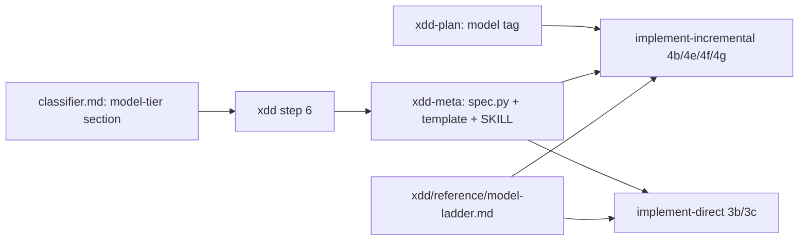
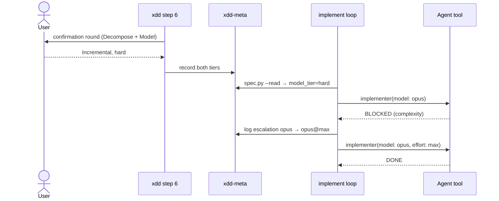

# Solution Design Document

## Validation Checklist

### CRITICAL GATES (Must Pass)

- [x] All required sections are complete
- [x] No [NEEDS CLARIFICATION] markers remain
- [x] Architecture pattern is clearly stated with rationale
- [x] **All architecture decisions confirmed by user**
- [x] Every interface has specification

### QUALITY CHECKS (Should Pass)

- [x] All context sources are listed with relevance ratings
- [x] Project commands are discovered from actual project files
- [x] Constraints → Strategy → Design → Implementation path is logical
- [x] Every component in diagram has directory mapping
- [x] Error handling covers all error types
- [x] Quality requirements are specific and measurable
- [x] Component names consistent across diagrams
- [x] A developer could implement from this design
- [x] Implementation examples use actual schema column names (not pseudocode), verified against migration files
- [x] Complex queries include traced walkthroughs with example data showing how the logic evaluates

---

## Output Schema

### SDD Status Report

| Field | Type | Required | Description |
|-------|------|----------|-------------|
| specId | string | Yes | Spec identifier (NNN-name format) |
| architecture | ArchitectureSummary | Yes | Architecture overview |
| sections | SectionStatus[] | Yes | Status of each SDD section |
| adrs | ADRStatus[] | Yes | Architecture decision statuses |
| validationPassed | number | Yes | Validation items passed |
| validationPending | number | Yes | Validation items pending |
| nextSteps | string[] | Yes | Recommended next actions |

### ArchitectureSummary

| Field | Type | Required | Description |
|-------|------|----------|-------------|
| pattern | string | Yes | Selected architecture pattern |
| keyComponents | string[] | Yes | Main system components |
| externalIntegrations | string[] | No | External services integrated |

### SectionStatus

| Field | Type | Required | Description |
|-------|------|----------|-------------|
| name | string | Yes | Section name |
| status | enum: `COMPLETE`, `NEEDS_DECISION`, `IN_PROGRESS` | Yes | Current state |
| detail | string | No | What decision is needed or what's in progress |

### ADRStatus

| Field | Type | Required | Description |
|-------|------|----------|-------------|
| id | string | Yes | ADR identifier (e.g., ADR-1) |
| name | string | Yes | Decision name |
| status | enum: `CONFIRMED`, `PENDING` | Yes | Confirmation state |

---

## Constraints

- **CON-1** Markdown skills, no runtime. The only executable component in scope is
  `xdd-meta/spec.py`, Python standard library only (spec 017, CON-1).
- **CON-2** The decomposition step keeps exactly one confirmation round (spec 017, CON-8).
  `test_xdd_adds_no_question_beyond_the_tier_confirmation` counts the literal `AskUserQuestion` in
  step 6 and allows at most one; that one is the existing Finalize gate. The tier question is
  prose (`**Ask** the user to choose …`), so the model-tier question must be prose too.
- **CON-3** Specs without a `Model tier` row read cleanly and implement exactly as today
  (spec 017, CON-5). Every existing spec under `docs/XDD/specs/` must still pass
  `test_every_existing_spec_reads_cleanly`.
- **CON-4** The TDD gate (tdd-guardian before every implementer) and the review chain (4f before
  4g) are unchanged.
- **CON-5** TCS chooses models for subagents only. The Agent tool accepts the aliases `haiku`,
  `sonnet`, `opus`, `fable` and, from Claude Code 2.1.292, a per-dispatch `effort`
  (`low`…`max`). It does not accept full model IDs or `inherit`.
- **CON-6** One plugin (tcs-workflow), one version bump, root and plugin CHANGELOG entries.
- **CON-7** Every changed skill passes the skill-author audit.

## Implementation Context

**IMPORTANT**: You MUST read and analyze ALL listed context sources to understand constraints, patterns, and existing architecture.

### Required Context Sources

#### Documentation Context

```yaml
# Internal documentation and patterns
- doc: docs/XDD/specs/022-model-tier-classification/requirements.md
  relevance: HIGH
  why: "The 27 acceptance criteria (AC-1.1 … AC-6.4) this design traces to"

- doc: docs/XDD/specs/017-complexity-tier-dispatch/solution.md
  relevance: HIGH
  why: "Contract this extends: recommend-never-apply, three-place recording (ADR-6), CON-5, CON-8"

- doc: plugins/tcs-helper/skills/skill-author/reference/conventions.md
  relevance: MEDIUM
  why: "Audit rules every changed SKILL.md must pass (CON-7)"

# External documentation and APIs
- url: https://code.claude.com/docs/en/sub-agents.md
  relevance: HIGH
  sections: ["Choose a model", "Frontmatter reference"]
  why: "Agent tool model aliases, per-dispatch effort, allowlist substitution"

- url: https://code.claude.com/docs/en/model-config.md
  relevance: HIGH
  sections: ["Effort levels", "Fallback", "Fable"]
  why: "Fable consent and usage-credit billing, fallback chains"
```

#### Code Context

```yaml
- file: plugins/tcs-workflow/skills/xdd/reference/classifier.md
  relevance: HIGH
  why: "Gains the model-tier section"

- file: plugins/tcs-workflow/skills/xdd/SKILL.md
  relevance: HIGH
  why: "Step 6 gains the model-tier question in the same confirmation round"

- file: plugins/tcs-workflow/skills/xdd-meta/spec.py
  relevance: HIGH
  why: "read_decomposition_tier (lines ~118-151) generalises; read_spec prints model_tier"

- file: plugins/tcs-workflow/skills/xdd-meta/template.md
  relevance: HIGH
  why: "Gains the Model tier Status row and its legend"

- file: plugins/tcs-workflow/skills/xdd-meta/SKILL.md
  relevance: MEDIUM
  why: "Interface and rules name the decomposition tier; the model tier is added beside it"

- file: plugins/tcs-workflow/skills/implement-incremental/SKILL.md
  relevance: HIGH
  why: "Steps 4b (model selection), 4e (status handling), 4f/4g (review loops)"

- file: plugins/tcs-workflow/skills/implement-direct/SKILL.md
  relevance: HIGH
  why: "Steps 3b (implementer dispatch) and 3c (status handling)"

- file: plugins/tcs-workflow/skills/implement/SKILL.md
  relevance: LOW
  why: "Not modified: at its 99-line test budget and owns no references; the loops link ../xdd/reference/model-ladder.md"

- file: plugins/tcs-workflow/skills/xdd-plan/reference/task-structure.md
  relevance: MEDIUM
  why: "Metadata table gains [model: tier]"

- file: tests/test_spec_tier.py
  relevance: HIGH
  why: "Pattern for the model_tier reader tests"

- file: tests/test_classifier_rules.py
  relevance: HIGH
  why: "Pattern for an independent rules copy plus lockstep tests on classifier.md and step 6"
```

#### External APIs

```yaml
- service: Claude Code Agent tool
  doc: https://code.claude.com/docs/en/sub-agents.md
  relevance: HIGH
  why: "model and effort parameters on dispatch; error or substitution when a model is unavailable"
```

### Implementation Boundaries

- **Must Preserve**: decomposition classifier rules and outputs; `decomposition_tier` key and its
  reader behaviour; tdd-guardian and reviewer dispatch; all `model:` frontmatter of existing agents;
  behaviour of every spec without a `Model tier` row.
- **Can Modify**: `classifier.md`, new `xdd/reference/model-ladder.md`, xdd step 6, `spec.py`,
  `xdd-meta/template.md`, `xdd-meta/SKILL.md`, `xdd-plan/template.md`,
  implement-incremental 4b/4e/4f/4g, implement-direct 3b/3c, `task-structure.md`, xdd-plan Task
  interface, tcs-workflow README and CHANGELOG.
- **Must Not Touch**: tcs-team agents, reviewer agents' models, main-session model, any hook, the
  dispatcher `implement/SKILL.md`.

### External Interfaces

#### System Context Diagram

```mermaid
graph TB
    User[Maintainer / adopter] -->|confirms tiers, consents to fable| XDD[xdd step 6]
    XDD -->|records| README[(spec README)]
    README -->|spec.py --read model_tier| IMPL[implement-direct / implement-incremental]
    PLAN[(plan/phase-N.md [model:] tags)] --> IMPL
    IMPL -->|Agent tool: model + effort| CC[Claude Code subagent runtime]
    CC -->|result, BLOCKED, or dispatch error| IMPL
    IMPL -->|Decisions Log rows via xdd-meta| README
    IMPL -->|AskUserQuestion: fable consent| User
```

#### Interface Specifications

```yaml
# Inbound Interfaces
inbound:
  - name: "xdd step 6 confirmation"
    type: one confirmation round, two questions (prose in step 6, no extra tool mention)
    format: "Decompose: Direct|Incremental; Model: routine|hard|frontier"
    data_flow: "User's tier choices"

# Outbound Interfaces
outbound:
  - name: "Implementer dispatch"
    type: Agent tool
    format: "model: haiku|sonnet|opus|fable; effort: max (only on the opus@max rung)"
    criticality: HIGH

# Data Interfaces
data:
  - name: "Spec README Status table"
    type: Markdown table
    connection: "spec.py --read"
    data_flow: "Model tier row → model_tier key"
  - name: "Spec README Decisions Log"
    type: Markdown table
    connection: "xdd-meta step 4 (Log Decision)"
    data_flow: "Tier, escalation, consent and substitution rows"
```

### Cross-Component Boundaries

- **API contract**: `spec.py --read` output is consumed by `implement`; adding a key is additive.
- **Breaking change policy**: none permitted. Existing keys and their values stay identical.

### Project Commands

```bash
# Core Commands (discovered from project files)
Test (python): rm -rf tests/__pycache__ && .venv/bin/python -m pytest -q tests
Changelog:     bash scripts/ci/check-changelog-version-sync.sh --allow-ahead 1
Spec read:     python3 plugins/tcs-workflow/skills/xdd-meta/spec.py <id> --read
```

## Solution Strategy

- **Architecture Pattern**: extend the existing recommend → confirm → record → consume pipeline
  from spec 017 with a second axis. No new mechanism, no new skill.
- **Integration Approach**: the classifier computes both tiers in one pass; xdd step 6 confirms
  both in one call; spec.py exposes the model tier beside the decomposition tier; both implement
  loops resolve each task's rung through one shared ladder reference and escalate by its rules.
- **Justification**: the decomposition tier already proved the contract (recommendation only,
  three-place recording, fail-open read). Reusing it keeps CON-2 and CON-3 true by construction and
  gives the maintainer one mental model for both tiers.
- **Key Decisions**: ADR-1 to ADR-7 below.

## Building Block View

### Components



| Component | New / modified | Owns |
|---|---|---|
| Model-tier classifier (`classifier.md` section) | modified | Depth signals, ordered rules, rationale |
| xdd step 6 | modified | Asking both tiers in one call; handing both to xdd-meta |
| Spec metadata (`spec.py`, `template.md`, xdd-meta SKILL) | modified | `Model tier` row, its reader, `model_tier` key |
| Model ladder (`xdd/reference/model-ladder.md`) | **new** | Rungs, tier → starting rung, escalation triggers and cap, "no one can be asked", fable consent rule, substitution rule, the cost sentence, log row formats |
| implement-incremental | modified | Applying the ladder at 4b; counting review failures; escalating at 4e/4f/4g |
| implement-direct | modified | Applying the ladder at 3b; escalating at 3c |
| Plan task tag (`task-structure.md`, xdd-plan interface) | modified | The `[model: tier]` annotation |

### Directory Map

**Component**: tcs-workflow

```
plugins/tcs-workflow/
├── skills/
│   ├── xdd/
│   │   ├── SKILL.md                          # MODIFY: step 6 asks the model tier in the same round (prose)
│   │   └── reference/
│   │       ├── classifier.md                 # MODIFY: add "Model Tier" section
│   │       └── model-ladder.md               # NEW: the single ladder
│   ├── xdd-meta/
│   │   ├── SKILL.md                          # MODIFY: interface + rules name the model tier
│   │   ├── spec.py                           # MODIFY: read_status_row, KNOWN_MODEL_TIERS, model_tier
│   │   └── template.md                       # MODIFY: Model tier row + legend
│   ├── xdd-plan/
│   │   ├── SKILL.md                          # MODIFY: Task interface gains model?
│   │   ├── template.md                       # MODIFY: Metadata Reference lists [model:]
│   │   └── reference/task-structure.md       # MODIFY: [model: tier] metadata row
│   ├── implement-incremental/SKILL.md        # MODIFY: 4b, 4e, 4f, 4g, YOLO note
│   └── implement-direct/SKILL.md             # MODIFY: 3b, 3c
├── README.md                                 # MODIFY: model tier + minimum CC version for effort
└── CHANGELOG.md                              # MODIFY
tests/
├── test_spec_tier.py                         # MODIFY: model_tier reader cases
├── test_classifier_rules.py                  # MODIFY: model-tier rules copy + lockstep
├── test_model_ladder.py                      # NEW: lockstep tests on model-ladder.md (T2.1)
├── test_plan_model_tag.py                    # NEW: [model:] annotation (T2.2)
├── test_implement_incremental_ladder.py      # NEW: 4b/4e/4f/4g consume the ladder (T3.3)
└── test_implement_direct_ladder.py           # NEW: 3b/3c consume the ladder (T3.4)
```

### Interface Specifications

#### Interface Documentation References

```yaml
- doc: plugins/tcs-workflow/skills/xdd/reference/classifier.md
  relevance: HIGH
  sections: [Inputs, Classification, Rationale Output, Decision Logging]
- doc: docs/XDD/specs/017-complexity-tier-dispatch/solution.md
  relevance: MEDIUM
  sections: [ADR-6]
```

#### Data Storage Changes

No database. The only stored data is Markdown in the spec README:

```
Status table, new row (template default is the placeholder):
| **Model tier** | {{MODEL_TIER}} |
Recognised values (case-insensitive): routine | hard | frontier
```

#### Internal API Changes

`spec.py <id> --read` gains one top-level TOML key, printed directly after `decomposition_tier`:

```toml
decomposition_tier = "incremental"
model_tier = "hard"        # "" when absent, placeholder, or unrecognised
```

`spec.py` internals:

```python
KNOWN_TIERS = ("direct", "incremental")              # unchanged
KNOWN_MODEL_TIERS = ("routine", "hard", "frontier")

def read_status_row(spec_dir: Path, label: str, known: tuple[str, ...]) -> str: ...
def read_decomposition_tier(spec_dir: Path) -> str:   # kept, delegates
    return read_status_row(spec_dir, "decomposition tier", KNOWN_TIERS)
def read_model_tier(spec_dir: Path) -> str:
    return read_status_row(spec_dir, "model tier", KNOWN_MODEL_TIERS)
```

#### Application Data Models

```pseudocode
ENTITY: ModelTier = routine | hard | frontier | absent
ENTITY: Rung = haiku | sonnet | opus | opus@max | fable   (ordered)
  opus@max ≡ Agent(model: opus, effort: max)
ENTITY: TaskDispatchState (held by the orchestrator, per task, not persisted)
  FIELDS: tier, rung, failures_at_rung (consecutive 4f/4g FAILs at the current rung; reset on
          escalation and on PASS), fable_consent (bool), planned (bool: started on fable by a confirmed frontier spec tier, or by a
          consented `[model: frontier]` tag)
ENTITY: RunState (orchestrator, per implement run)
  FIELDS: fable_unavailable (bool)
```

#### Integration Points

- **xdd → xdd-meta**: step 6 passes both confirmed tiers and both rationales; xdd-meta writes the
  Status rows and one Decisions Log row per tier.
- **implement loops → spec.py**: each loop already invokes `xdd-meta` to read the spec; it takes
  `model_tier` from that same `--read` output. The dispatcher passes nothing new.
- **implement-* → model-ladder.md**: both loops read it at dispatch and on escalation, linked as
  `../xdd/reference/model-ladder.md` (skills already link siblings this way, e.g. the dispatcher's
  `../implement-direct/SKILL.md`). The dispatcher (`implement/SKILL.md`) is not touched: it owns no
  references and sits at its 99-line budget.
- **implement-* → xdd-meta step 4**: escalation, consent and substitution rows.

### Implementation Examples

#### Example: Model-tier rules

**Why this example**: the rules are ordered; a traced case shows why `change_type == doc` comes first.

```
1. routine   if change_type == doc
2. frontier  if novel_pattern AND high_risks >= 2
3. hard      if novel_pattern OR high_risks >= 1 OR adr_count >= 3
4. routine   otherwise
```

Signals:

| Signal | Source | How to compute |
|---|---|---|
| `change_type` | as for the decomposition tier | shared |
| `high_risks` | requirements.md, Risks and Mitigations table | rows whose Impact cell is `High` |
| `novel_pattern` | solution.md, Pattern Documentation | true when "New patterns created" lists at least one entry |
| `adr_count` | solution.md, Architecture Decisions | number of ADR entries |

Undeterminable → `high_risks = 0`, `novel_pattern = false`, `adr_count = 0`, named in the rationale.

Traced walkthroughs:

| Spec | change_type | high_risks | novel_pattern | adr_count | Rule | Tier |
|---|---|---|---|---|---|---|
| Doc rewrite with one High risk and a new doc pattern | doc | 1 | true | 1 | 1 | routine |
| This spec (022) | feature | 0 | false | 7 | 3 (`adr_count >= 3`) | hard |
| New consensus protocol, two High risks | feature | 2 | true | 4 | 2 | frontier |
| Small fix, one Medium risk | fix | 0 | false | 0 | 4 | routine |
| Spec with no SDD Pattern section, one High risk | feature | 1 | false (undeterminable) | 2 | 3 | hard |

#### Example: Step 6 confirmation (one call)

**Why this example**: CON-2 allows one confirmation round, and step 6 may not name the tool a
second time. Step 6's "Ask" bullet becomes, in prose:

```
4. **Ask** the user to choose, in one question round with two questions:
   - under header "Decompose": Direct | Incremental (recommendation highlighted)
   - under header "Model": routine | hard | frontier (recommendation highlighted; the frontier
     option carries the cost sentence from model-ladder.md)
   An override reason comes from the free-text answer; without one, log "no reason given".
```

Cost sentence (owned by `model-ladder.md`; step 6 reads that file and copies the sentence into the
option text at run time): "Fable costs about 2.5× Opus per token and can bill usage credits instead
of your plan's limits." It appears once, on the `frontier` option.

#### Example: Escalation

**Why this example**: the review-failure counter spans 4f and 4g, and the fable step branches on
whether anyone can be asked.

```
on implementer result for task T at rung R:
  BLOCKED(complexity)        → escalate(T)
  BLOCKED(other reason)      → today's handling, no escalation
on reviewer PASS for task T:  T.failures_at_rung = 0
on reviewer FAIL (4f or 4g) for task T:
  T.failures_at_rung += 1
  if T.failures_at_rung == 2 → escalate(T) and re-dispatch with the fix list
  else                       → re-dispatch at R with the fix list (today)

escalate(T):
  T.failures_at_rung = 0
  next = rung after T.rung
  if T.rung == fable or (T.rung == opus@max and run.fable_unavailable)
                                    → report BLOCKED to user; stop   # caps every review loop
  if next != fable                  → T.rung = next; log escalation; re-dispatch
  if nobody can be asked            → log "fable not reached: no one to ask"; report BLOCKED at opus@max
                                      # also the cap for unattended runs
  ask user with cost sentence:
    yes → T.rung = fable; T.fable_consent = true; log consent + escalation; re-dispatch
    no  → log declined; report BLOCKED at opus@max

on fable dispatch error or dismissed Claude Code consent prompt for task T:
  run.fable_unavailable = true
  if T.planned  → T.rung = opus@max; log substitution; re-dispatch; continue
  else          → log substitution refused; report BLOCKED   # opus@max already failed

nobody can be asked  ≡  YOLO=true, or the confirmation question returns no answer or an error
                        (claude -p, Agent SDK)
```

#### Test Examples as Interface Documentation

```python
def test_model_tier_reads_recorded_value(tmp_path):
    spec = _make_spec(tmp_path, model_tier="Hard")
    assert _model_tier_of(spec) == "hard"

def test_model_tier_absent_reads_empty(tmp_path):
    spec = _make_spec(tmp_path)              # no Model tier row
    assert _model_tier_of(spec) == ""
```

## Runtime View

### Primary Flow

#### Primary Flow: Classify, then implement a task that escalates

1. xdd step 6 reads requirements.md and solution.md and computes both tiers with rationales.
2. One question round with two questions; the user confirms or overrides each.
3. xdd-meta writes `Decomposition tier` and `Model tier` Status rows and one Decisions Log row each.
4. `/implement` reads `--read`; `model_tier = "hard"`.
5. For each task: tag `[model:]` if present, else the spec tier; resolve the starting rung via
   the ladder; dispatch tdd-guardian (unchanged), then the implementer with `model` (and `effort`
   on opus@max).
6. On a second review FAIL or a complexity BLOCKED, escalate one rung and log it.



### Error Handling

| Error | Handling |
|---|---|
| `model_tier` absent, placeholder or unknown | Treated as absent: today's selection (4b in Incremental; inherited session model in Direct) |
| Unknown `[model:]` tag value | Spec tier applies; the orchestrator reports the unknown value once for that task |
| Agent tool rejects `effort` (Claude Code < 2.1.292) | Re-dispatch at `opus` without effort; log the substitution with reason "effort unsupported" |
| Fable dispatch returns an error (not entitled, refused) or its consent prompt is dismissed | Fable marked unavailable for the run. Planned frontier task: re-dispatch at opus@max, log the substitution, continue. Escalated task: log it, report BLOCKED |
| Silent substitution by Claude Code | Recorded only if the spike (plan task 1) finds an observable signal; otherwise the log row says "requested" and README documents the limit |
| Task at its highest reachable rung fails review twice in a row or blocks on complexity | Report BLOCKED to the user; no further rung, no further retry |
| Fable needed and nobody can be asked | Never dispatched; BLOCKED at opus@max with a log row |

### Complex Logic

Starting rung (ADR-4):

```
tier = task.[model:] if recognised else spec.model_tier
match (tier, decomposition):
  (absent, incremental)   → 4b as today
  (absent, direct)        → no model parameter (inherits session model); the first
                            escalation goes to opus, then follows the ladder
  (routine, incremental)  → 4b as today
  (routine, direct)       → sonnet
  (hard, *)               → opus
  (frontier, *)           → fable; if the task tag says frontier but the spec tier is not
                            frontier, ask for consent first: yes → fable, and the task counts
                            as planned; no, a dismissed prompt, or no one to ask → hard
```

## Deployment View

No change to deployment. Shipped by merge to `main`; the auto-bump workflow versions tcs-workflow.
README states that the `opus@max` rung needs Claude Code 2.1.292 or later.

## Cross-Cutting Concepts

### Pattern Documentation

```yaml
# Existing patterns used in this feature
- pattern: Recommend-confirm-record (spec 017 classifier)
  relevance: HIGH
  why: "Second axis uses the same contract"
- pattern: Fail-open Status-row reader (spec.py, CON-5)
  relevance: HIGH
  why: "Generalised, not duplicated"

# New patterns created for this feature
# none — the ladder is a reference file beside the existing classifier (xdd/reference/)
```

### User Interface & UX

The only UI is question text: the step 6 confirmation round (two questions) and the runtime
fable consent question. Both carry the same cost sentence from `model-ladder.md`.

### System-Wide Patterns

- **Error handling**: no model problem ever stops a run; it degrades a rung and logs it.
- **Logging**: Decisions Log rows only, through xdd-meta step 4. Formats:
  - `| <date> | Model tier: hard | Classifier recommended hard (adr_count=7). Accepted. |`
  - `| <date> | Model escalation: T2.1 opus → opus@max | Trigger: second review FAIL |`
  - `| <date> | Fable consent: T2.1 | Asked at escalation; user agreed |`
  - `| <date> | Model substitution: T2.1 | Requested fable, ran opus@max: dispatch error <reason> |`
- **Security / cost**: fable is reached only with consent given at classification (planned) or
  at the time (escalation or a frontier tag in a non-frontier spec).

## Architecture Decisions

- [x] ADR-1 Model tier lives in the existing classifier: a second section in
  `xdd/reference/classifier.md`, computed in the same step 6 pass, confirmed in the same
  confirmation round as a second question, written as prose so step 6 still names the tool once.
  - Rationale: CON-2 allows one confirmation round; one classifier keeps one mental model.
  - Trade-offs: classifier.md grows; the step 6 question becomes denser.
  - User confirmed: 2026-10-28

- [x] ADR-2 Depth signals `high_risks`, `novel_pattern`, `adr_count`, plus `change_type`;
  ordered rules doc → routine, novel+2 high risks → frontier, any of novel / 1 high risk / 3 ADRs
  → hard, else routine; undeterminable signals lower the tier.
  - Rationale: all four are countable in documents the workflow already wrote; frontier stays rare.
  - Trade-offs: proxies for depth, not depth itself; tuned later via the override rate.
  - User confirmed: 2026-10-28

- [x] ADR-3 One ladder, haiku → sonnet → opus → opus@max → fable, in
  `xdd/reference/model-ladder.md`, linked by both loops. opus@max is `opus` with
  per-dispatch `effort: max`.
  - Rationale: "stronger model" means one thing everywhere; effort before model halves the cost of
    the step before frontier.
  - Trade-offs: a cross-skill link; opus@max needs Claude Code 2.1.292.
  - User confirmed: 2026-10-28

- [x] ADR-4 Starting rungs: absent → today's behaviour; routine → 4b (Incremental) or sonnet
  (Direct); hard → at least opus; frontier → fable. A `[model:]` task tag overrides the spec tier.
  - Rationale: legacy specs unchanged (CON-3); Direct gains an explicit choice only when a tier is
    recorded.
  - Trade-offs: absent and routine differ in Direct.
  - User confirmed: 2026-10-28

- [x] ADR-5 Escalate one rung on a complexity BLOCKED or the second review FAIL of the same task
  (4f and 4g counted together, two in a row at the same rung, count reset on escalation); automatic
  up to opus@max; fable only after a consent question with the cost sentence; when no one can be
  asked (YOLO, or the question returns no answer), stop at opus@max as BLOCKED. At the highest
  reachable rung the same trigger reports BLOCKED, so review loops are bounded. Fable failure:
  planned task → opus@max and continue; escalated task → BLOCKED; fable off for the run.
  Amended after spec validation, confirmed 2026-10-28.
  - Rationale: cost follows evidence; spending outside the plan is always a person's decision.
  - Trade-offs: a task that needed fable fails in unattended runs instead of finishing.
  - User confirmed: 2026-10-28

- [x] ADR-6 Escalations, consents and substitutions are Decisions Log rows written through
  xdd-meta step 4. The plan's first task is a spike on observing the model that actually ran;
  until it finds a signal, rows record the requested rung and the README documents the limit.
  - Rationale: one audit trail per spec; no new telemetry.
  - Trade-offs: silent substitutions may go unrecorded.
  - User confirmed: 2026-10-28

- [x] ADR-7 `spec.py` generalises its reader to `read_status_row(spec_dir, label, known)`, adds
  `KNOWN_MODEL_TIERS` and prints `model_tier`; the template gains the `Model tier` row.
  - Rationale: one fail-open reader instead of two copies.
  - Trade-offs: touches tested code; existing tests guard it.
  - User confirmed: 2026-10-28

## Quality Requirements

- **Compatibility**: `pytest -q tests` passes; every existing spec reads with
  `model_tier = ""` and an unchanged `decomposition_tier`.
- **Determinism**: the same two documents always give the same model tier (independent Python
  copy of the rules in `test_classifier_rules.py`).
- **Cost safety**: zero routes to a fable dispatch without consent, checked by lockstep tests on
  `model-ladder.md` and both implement skills.
- **Conversation cost**: step 6 keeps one confirmation round (existing CON-8 test unchanged and green).
- **Audit**: every changed SKILL.md passes the skill-author audit.

## Acceptance Criteria

**Feature 1 — Model-tier classification**
- [ ] (PRD/AC-1.1) WHEN step 6 runs on a spec with requirements.md and solution.md, THE SYSTEM SHALL recommend exactly one model tier from `high_risks`, `novel_pattern`, `adr_count` and `change_type`, and name them in the rationale.
- [ ] (PRD/AC-1.2) THE SYSTEM SHALL confirm both tiers in step 6's single confirmation round and ask nothing else there.
- [ ] (PRD/AC-1.3) THE SYSTEM SHALL show the cost sentence from `model-ladder.md` once, on the `frontier` option of the step 6 question.
- [ ] (PRD/AC-1.4) IF a depth signal cannot be determined, THEN THE SYSTEM SHALL use the value that lowers the tier and name it in the rationale.
- [ ] (PRD/AC-1.5) WHEN the user overrides the model-tier recommendation, THE SYSTEM SHALL log the recommendation, the choice and the free-text reason, or "no reason given".

**Feature 2 — Model tier recorded**
- [ ] (PRD/AC-2.1) WHEN a model tier is confirmed, THE SYSTEM SHALL write the `Model tier` Status row and one Decisions Log row.
- [ ] (PRD/AC-2.2) WHEN `spec.py --read` runs on a spec with a recognised `Model tier`, THE SYSTEM SHALL print `model_tier` with the lowercased value directly after `decomposition_tier`.
- [ ] (PRD/AC-2.3) IF the `Model tier` row is absent, a placeholder or unrecognised, THEN THE SYSTEM SHALL print `model_tier = ""` and exit 0, and every existing spec SHALL keep its current `decomposition_tier`.

**Feature 3 — Per-task override**
- [ ] (PRD/AC-3.1) WHEN a task carries a recognised `[model: tier]` tag, THE SYSTEM SHALL resolve its starting rung from the tag.
- [ ] (PRD/AC-3.2) IF a task's `[model:]` value is unrecognised, THEN THE SYSTEM SHALL use the spec tier and report the value.
- [ ] (PRD/AC-3.3) IF a task is tagged `frontier` in a spec whose tier is not `frontier`, THEN THE SYSTEM SHALL ask for consent with the cost sentence before dispatch, treat a consented task as planned, and use the `hard` rung when the user declines or no one can be asked.

**Feature 4 — Ladder**
- [ ] (PRD/AC-4.1) WHILE the tier is `routine` in Incremental, THE SYSTEM SHALL select the rung by step 4b's existing rules.
- [ ] (PRD/AC-4.2) WHILE the tier is `hard`, THE SYSTEM SHALL start no lower than `opus`.
- [ ] (PRD/AC-4.3) WHILE the spec tier is a confirmed `frontier`, THE SYSTEM SHALL dispatch frontier tasks with `model: fable`.
- [ ] (PRD/AC-4.4) THE SYSTEM SHALL apply the same ladder and tier mapping in implement-direct as in implement-incremental, with `routine` mapping to `sonnet` in Direct.
- [ ] (PRD/AC-4.5) WHILE `model_tier` is absent, THE SYSTEM SHALL select models exactly as before this feature.

**Feature 5 — Escalation**
- [ ] (PRD/AC-5.1) WHEN a task returns BLOCKED for complexity or fails review twice in a row at the same rung (4f and 4g counted together), THE SYSTEM SHALL re-dispatch it exactly one rung higher and reset its failure count.
- [ ] (PRD/AC-5.2) WHEN the next rung is at most opus@max, THE SYSTEM SHALL escalate without asking.
- [ ] (PRD/AC-5.3) WHEN the next rung is fable in an interactive session, THE SYSTEM SHALL ask with the cost sentence before dispatching.
- [ ] (PRD/AC-5.4) IF the next rung is fable and YOLO is set or the consent question returns no answer, THEN THE SYSTEM SHALL not dispatch fable and SHALL report the task BLOCKED at opus@max.
- [ ] (PRD/AC-5.5) WHEN a task escalates, THE SYSTEM SHALL log the task, trigger, and rung before and after.
- [ ] (PRD/AC-5.6) IF a task is BLOCKED for context, size or a wrong plan, THEN THE SYSTEM SHALL not escalate.
- [ ] (PRD/AC-5.7) IF a task at its highest reachable rung blocks on complexity or fails review twice in a row, THEN THE SYSTEM SHALL report it BLOCKED to the user and stop retrying.

**Feature 6 — Fable never required**
- [ ] (PRD/AC-6.1) WHEN a planned frontier task's fable dispatch returns an error, THE SYSTEM SHALL re-dispatch it at opus@max and continue.
- [ ] (PRD/AC-6.2) WHEN a substitution occurs, THE SYSTEM SHALL log the requested rung, the rung that ran and the reason.
- [ ] (PRD/AC-6.3) THE SYSTEM SHALL start implementation of a `frontier` spec on any account, whether or not Fable is available.
- [ ] (PRD/AC-6.4) WHEN an escalated task's fable dispatch errors or its Claude Code consent prompt is dismissed, THE SYSTEM SHALL report the task BLOCKED and not dispatch fable again in that run.

## Risks and Technical Debt

### Known Technical Issues

- Silent substitution (overload fallback, allowlist) is not observable from SubagentStop input;
  whether the subagent transcript carries the model is unconfirmed (spike).
- Consent behaviour of a fable subagent inside an interactive session is undocumented (spike).
- `CLAUDE_CODE_NO_MODEL_FALLBACK` is undocumented; this design does not rely on it.

### Technical Debt

- The YOLO note in implement-incremental mentions a "4b (model selection confirmation)" that 4b
  never defined. This spec defines 4b's confirmation as none and removes the stale reference.
- `read_decomposition_tier` scans every table row, not only the Status table; the generalised
  reader keeps that behaviour (a label match is specific enough) rather than widening scope.

### Implementation Gotchas

- `test_xdd_adds_no_question_beyond_the_tier_confirmation` counts the literal string
  `AskUserQuestion` from `### 6. Decompose` to `### 7.`; the Finalize gate already uses it. Write the
  model-tier question as prose under the existing `**Ask** the user to choose` line (keep that exact
  text) and never write the tool name in step 6 again.
- Step 6 strings that existing tests check must survive verbatim: the five signal names,
  `Surface`, `**Direct**`, `**Incremental**`, `may override freely`,
  `Direct      => write no decomposition artifact`, `Skill(tcs-workflow:xdd-plan)`, `Status table`,
  `Decisions Log`, `` `plan/` row `skipped` `` (`tests/test_classifier_rules.py:233-300`).
- Existing classifier tests run over the whole of `classifier.md`; slice the new model-tier tests by
  section heading so they cannot mask a regression in the decomposition section.
- `implement-incremental/SKILL.md` is already over the orchestrator size budget (303 lines); the
  skill-author audit for T3.3 covers the changed sections and must not grow the file materially.
- `tests/test_spec_tier.py::_make_spec` takes only `tier=`; extend it with `model_tier=`.
- `CLAUDE_CODE_EFFORT_LEVEL` in the user's environment overrides a per-dispatch effort; README
  notes it.
- The Agent tool takes aliases only; never write a full model ID in the ladder.
- Fable prices change: the cost sentence states the ratio and the billing route, not prices.

## Glossary

### Domain Terms

| Term | Definition | Context |
|------|------------|---------|
| Decomposition tier | Direct or Incremental; how work is broken down | spec 017 |
| Model tier | routine, hard or frontier; how demanding the work is | this spec |
| Rung | One step of the model ladder | implement loops |
| Escalation | Re-dispatching a task one rung higher on evidence | ADR-5 |

### Technical Terms

| Term | Definition | Context |
|------|------------|---------|
| opus@max | Agent dispatch with `model: opus`, `effort: max` | ladder rung 4 |
| Substitution | A task ran on a different rung than requested | ADR-6 |
| Usage credits | Billing outside a plan's included limits | Fable cost sentence |

### API/Interface Terms

| Term | Definition | Context |
|------|------------|---------|
| `model_tier` | `spec.py --read` key | implement-direct, implement-incremental |
| `[model: tier]` | Plan task annotation | xdd-plan, implement-incremental |
