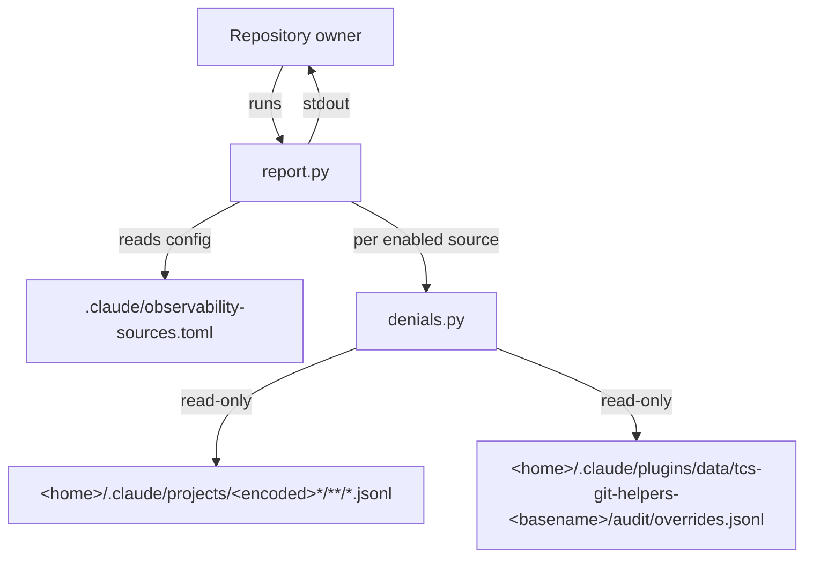
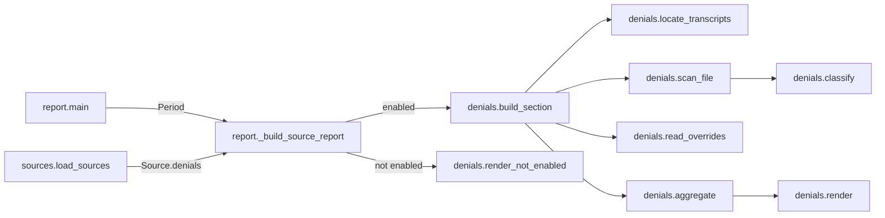
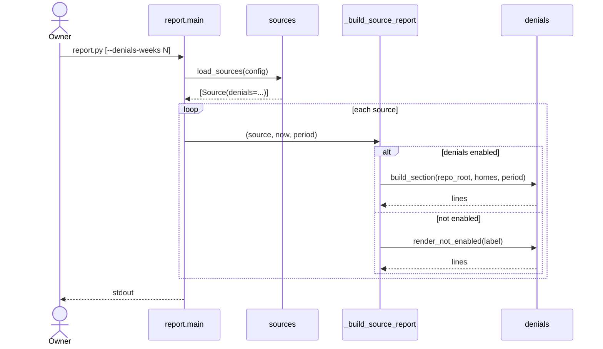

# Solution Design Document

## Validation Checklist

### CRITICAL GATES (Must Pass)

- [x] All required sections are complete
- [x] No [NEEDS CLARIFICATION] markers remain
- [x] Architecture pattern is clearly stated with rationale
- [x] **All architecture decisions confirmed by user**
- [x] Every interface has specification

### QUALITY CHECKS (Should Pass)

- [x] All context sources are listed with relevance ratings
- [x] Project commands are discovered from actual project files
- [x] Constraints → Strategy → Design → Implementation path is logical
- [x] Every component in diagram has directory mapping
- [x] Error handling covers all error types
- [x] Quality requirements are specific and measurable
- [x] Component names consistent across diagrams
- [x] A developer could implement from this design
- [x] Implementation examples use actual schema column names (not pseudocode), verified against migration files
- [x] Complex queries include traced walkthroughs with example data showing how the logic evaluates

---

## Output Schema

### SDD Status Report

| Field | Type | Required | Description |
|-------|------|----------|-------------|
| specId | string | Yes | Spec identifier (NNN-name format) |
| architecture | ArchitectureSummary | Yes | Architecture overview |
| sections | SectionStatus[] | Yes | Status of each SDD section |
| adrs | ADRStatus[] | Yes | Architecture decision statuses |
| validationPassed | number | Yes | Validation items passed |
| validationPending | number | Yes | Validation items pending |
| nextSteps | string[] | Yes | Recommended next actions |

### ArchitectureSummary

| Field | Type | Required | Description |
|-------|------|----------|-------------|
| pattern | string | Yes | Selected architecture pattern |
| keyComponents | string[] | Yes | Main system components |
| externalIntegrations | string[] | No | External services integrated |

### SectionStatus

| Field | Type | Required | Description |
|-------|------|----------|-------------|
| name | string | Yes | Section name |
| status | enum: `COMPLETE`, `NEEDS_DECISION`, `IN_PROGRESS` | Yes | Current state |
| detail | string | No | What decision is needed or what's in progress |

### ADRStatus

| Field | Type | Required | Description |
|-------|------|----------|-------------|
| id | string | Yes | ADR identifier (e.g., ADR-1) |
| name | string | Yes | Decision name |
| status | enum: `CONFIRMED`, `PENDING` | Yes | Confirmation state |

---

## Constraints

CON-1 Python 3.11 standard library only (`tomllib`, `json`, `pathlib`, `datetime`, `re`), as `report.py` and `sources.py` today; pytest-covered; runs offline, never on a hook path.
CON-2 Output privacy: no prompt, response, command, argument, path or message text from a transcript or from `overrides.jsonl` reaches the output (021 CON-13, 018 Won't Have). Allowed in output: category, hook name, rule name, tool name, classifier reason category, Claude Code version, session id, timestamp, counts, and this module's own fixed labels.
CON-3 Per-source sections, never pooled (019 ADR-7). Transcripts are read only for sources with `denials = true` (README Decisions Log).
CON-4 `sources.py` and the new `denials.py` import nothing local; `report.py` imports both (019 one-way import rule). No import from `plugins/` (021 CON-12: mirror the contract, not the code).
CON-5 Pure functions with explicit `now` and explicit paths; no real `$HOME`, no wall clock outside `report.main()` (report.py module contract).
CON-6 The transcript format is internal to Claude Code (sessions docs). Unknown shapes must not crash or silently count; checked range is Claude Code 2.1.71–2.1.332.
CON-7 Performance: a 28-day denials pass over this machine's enabled sources in under 60 s (PRD Quality KPI).

## Implementation Context

### Required Context Sources

#### Documentation Context
```yaml
- doc: docs/XDD/specs/024-observability-denials-report/requirements.md
  relevance: HIGH
  why: "Approved PRD; features F1-F9 and acceptance criteria"
- doc: docs/XDD/specs/024-observability-denials-report/research.md
  relevance: HIGH
  why: "Denial families with counts, fields, traps (api-request-blob copies, is_error), version drift"
- doc: docs/XDD/specs/019-observability-rollout-across-active-repos/solution.md
  relevance: HIGH
  why: "ADR-7 per-source sections, sources config schema, homes, one-way imports"
- doc: docs/XDD/specs/021-observability-v2/solution.md
  relevance: HIGH
  why: "CON-12, CON-13, Won't Have list this spec narrows"
- doc: plugins/tcs-helper/scripts/observability/README.md
  relevance: MEDIUM
  why: "User documentation that gains the denials part (F7)"
- url: https://code.claude.com/docs/en/hooks.md
  relevance: MEDIUM
  why: "Which denials have a hook event (only PermissionDenied for the classifier)"
- url: https://code.claude.com/docs/en/sessions.md
  relevance: MEDIUM
  why: "Transcript location; format is internal"
```

#### Code Context
```yaml
- file: scripts/observability/report.py
  relevance: HIGH
  why: "_build_source_report (per-source section), build_multi_source_report, main() argparse, _render_git_operations empty-state wording"
- file: scripts/observability/sources.py
  relevance: HIGH
  why: "_ALLOWED_SOURCE_KEYS, _parse_source_table, Source dataclass, ConfigSchemaError"
- file: tests/test_observability_report.py
  relevance: HIGH
  why: "Test style: tmp_path fixtures, explicit now, no real HOME"
- file: plugins/tcs-git-helpers/scripts/block-bad-git-ops.sh
  relevance: MEDIUM
  why: "Deny body 'tcs-git-helpers DENIED: N rule(s) matched' + '  - [RULE] …' lines (line ~210)"
- file: plugins/tcs-git-helpers/scripts/pre-edit-branch-check.sh
  relevance: MEDIUM
  why: "\"Refusing to ${TOOL} '${REL_PATH}' on '${BRANCH}'.\" (line 120)"
- file: plugins/tcs-git-helpers/scripts/worktree-exit-guard.sh
  relevance: MEDIUM
  why: "'Cannot exit worktree:' (line 211)"
- file: plugins/tcs-git-helpers/scripts/protect-git-internals.sh
  relevance: MEDIUM
  why: "'Refusing to ${TOOL} '…': edits to git-internal paths' reason"
- file: plugins/tcs-patterns/scripts/block-eslint-disable.sh
  relevance: MEDIUM
  why: "\"Refusing to ${TOOL} '${FILE_PATH}': ${VIOLATION} detected\" (line 189)"
- file: plugins/tcs-issues/scripts/require-issue-comments.sh
  relevance: MEDIUM
  why: "'This reads a GitHub issue without its comments.' (line 61)"
- file: plugins/tcs-git-helpers/scripts/lib/audit_log.sh
  relevance: MEDIUM
  why: "overrides.jsonl field set and path (plugin_data.sh: <home>/.claude/plugins/data/tcs-git-helpers-<basename>/audit/)"
```

#### External APIs (if applicable)
Not applicable: no network services. The only external data is files Claude Code and tcs-git-helpers write on this machine.

### Implementation Boundaries

- **Must Preserve**: every existing report section and its text; the `--events` single-record path byte-for-byte (019 golden fixture); `sources.py` error behaviour for existing keys; config files without `denials` keep working unchanged.
- **Can Modify**: `sources.py` (one new key, one new `Source` field), `report.py` (call the denials section, two CLI options), the observability README.
- **Must Not Touch**: the recorder scripts under `plugins/tcs-helper/scripts/observability/`, `logwrite.sh`'s record schema, tcs-git-helpers hooks and audit log format, any transcript file (read-only).

### External Interfaces

#### System Context Diagram



#### Interface Specifications

```yaml
inbound:
  - name: "report.py CLI"
    type: command line
    format: argparse
    data_flow: "Existing options plus --denials-weeks N | --denials-since YYYY-MM-DD"
  - name: "locations config"
    type: TOML file
    format: "[[source]] label, repo_root, homes, denials (new, bool)"
    data_flow: "Selects sources and which of them read transcripts"

outbound:
  - name: "report text"
    type: stdout
    format: plain text section per source
    data_flow: "Denials section appended to each source section"

data:
  - name: "Claude Code session transcripts"
    type: JSONL files, read-only
    connection: filesystem
    data_flow: "type=user lines with tool_result is_error=true; their tool_use counterpart for the tool name"
  - name: "tcs-git-helpers overrides.jsonl"
    type: JSONL file, read-only
    connection: filesystem
    data_flow: "ts and env_var of override consumption rows"
```

### Cross-Component Boundaries (if applicable)
- **API Contracts**: the `denials = true` key is a public config contract; documented in the observability README and `observability-sources.toml.example`.
- **Team Ownership**: TCS hook deny message openings are owned by their plugins; a change there must update `denials.py`'s table (noted in Risks).
- **Shared Resources**: none written.
- **Breaking Change Policy**: additive only; no existing output line changes.

### Project Commands

```bash
# Environment: python3 3.11+, venv with requirements-dev.txt (pytest, pyyaml)
Install: python -m pip install -r requirements-dev.txt
Unit Tests: pytest -q tests/test_observability_denials.py tests/test_observability_report.py tests/test_observability_sources.py
Full suite: pytest -q
Run: python3 scripts/observability/report.py --repo-root . [--denials-weeks 4]
```

## Solution Strategy

- **Architecture Pattern**: a pure reader module (`denials.py`) behind the existing per-source report assembly. `report.py` stays the only place that renders a source section and the only place that reads the wall clock; `denials.py` gets paths, a period and `now`, and returns a value object plus its rendered lines.
- **Integration Approach**: `sources.py` gains the `denials` key; `_build_source_report` calls `denials.build_section(...)` when the source is enabled, else renders the "not enabled" lines from the same module; `main()` parses the period options once and passes a `Period`.
- **Justification**: keeps the 2466-line `report.py` from growing a second subsystem (ADR-1), keeps the classification table in one reviewable place (ADR-4), and inherits per-source isolation and home handling from 019 unchanged.
- **Key Decisions**: transcripts read narrowly and only for enabled sources; first-match classification table; output limited to fixed labels and identifiers (CON-2).

## Building Block View

### Components



| Component | Responsibility (single owner) |
|---|---|
| `sources` | Parse and validate `denials`; carry it on `Source` |
| `report.main` | Parse `--denials-weeks/--denials-since` into a `Period`; supply `now` |
| `report._build_source_report` | Decide enabled vs not enabled; place the section in the source text |
| `denials.locate_transcripts` | Find candidate transcript files per home (ADR-3) |
| `denials.scan_file` | Read one file; yield error tool results in period with tool name, cwd, session, version, sidechain; dedupe (ADR-5); count skipped lines |
| `denials.classify` | Map one error text (+ tool name) to a `Denial` or none (ADR-4, ADR-8) |
| `denials.read_overrides` | Count override consumptions per rule in period (ADR-6) |
| `denials.aggregate` | Filter by repo (cwd), count per category, hook, rule, week, main/subagent; top 10 |
| `denials.render` / `render_not_enabled` | Produce the section's lines, including empty and partial states |

### Directory Map

**Component**: observability report
```
scripts/observability/
├── denials.py                          # NEW: locate, scan, classify, aggregate, render
├── report.py                           # MODIFY: call denials per source; --denials-weeks/--denials-since
├── sources.py                          # MODIFY: `denials` key, Source.denials
└── observability-sources.toml.example  # MODIFY: commented `denials = true`
tests/
├── test_observability_denials.py       # NEW
├── test_observability_report.py        # MODIFY: section placement, CLI options, --events unchanged
└── test_observability_sources.py       # MODIFY: `denials` key validation
plugins/tcs-helper/scripts/observability/
└── README.md                           # MODIFY: "Denials" part (F7)
```

### Interface Specifications

#### Interface Documentation References

```yaml
- name: "Locations config"
  doc: plugins/tcs-helper/scripts/observability/README.md#watching-several-repositories-at-once-the-locations-config
  relevance: HIGH
- name: "Claude Code hooks"
  doc: https://code.claude.com/docs/en/hooks.md
  relevance: MEDIUM
```

#### Data Storage Changes
None. Read-only over existing files; nothing is written or cached.

#### Internal API Changes

```yaml
sources:
  _ALLOWED_SOURCE_KEYS: {"label", "repo_root", "homes", "denials"}
  Source.denials: bool   # default False when the key is absent
  error: ConfigSchemaError(index, label, "denials must be true or false, got <repr>")  # ADR-2

denials:
  Period(start: datetime, end: datetime)            # end = now, start inclusive, UTC
  period_from_args(weeks: int | None, since: str | None, now: datetime) -> Period   # raises ValueError
  locate_transcripts(repo_root: Path, homes: Sequence[Path]) -> LocateResult
  scan_file(path: Path, period: Period) -> ScanResult
  classify(text: str, tool: str | None) -> Denial | None
  read_overrides(repo_root: Path, homes: Sequence[Path], period: Period) -> OverrideCounts
  aggregate(scans: Iterable[ScanResult], repo_root: Path, period: Period) -> DenialsSummary
  build_section(repo_root: Path, homes: Sequence[Path], period: Period) -> list[str]
  render_not_enabled(label: str) -> list[str]

report:
  _build_source_report(source, now, period)         # new parameter; appends denials lines
  main(): --denials-weeks INT (>=1), --denials-since YYYY-MM-DD (mutually exclusive)
```

#### Application Data Models

```pseudocode
ENTITY: ErrorResult (scan output, one per deduped tool result)
  FIELDS: file: Path, tool_use_id: str, tool: str | None, text: str (in memory only, never rendered),
          ts: datetime, cwd: str, session_id: str, version: str, sidechain: bool

ENTITY: Denial (classify output)
  FIELDS: category: str, hook: str | None, rules: tuple[str, ...], reason_category: str | None,
          confidence: "high" | "medium" | "low"

ENTITY: DenialsSummary (aggregate output)
  FIELDS: period, files_read: int, skipped_lines: int, oldest_ts, versions_seen: set[str],
          unknown_versions: set[str], by_category: Counter[(category, main|subagent)],
          by_rule: Counter[(hook, rule, main|subagent)], by_week: dict[week_start, Counter[category]],
          top: list[TopRow], unattributed: int, hook_denies: int

ENTITY: TopRow
  FIELDS: category, hook, rule, tool, count, overrides: int | None, last_session_id, last_ts

ENTITY: OverrideCounts
  FIELDS: by_rule: Counter[str], master: int
```

`ErrorResult.text` exists only between `scan_file` and `classify`; no other field carries transcript text, and `render` receives only `DenialsSummary` (CON-2).

#### Integration Points

```yaml
- from: report._build_source_report
  to: denials.build_section
  protocol: in-process call
  data_flow: "source.repo_root, [h.home for h in source.homes] deduped by _home_identity, Period"
- from: denials
  to: transcripts / overrides.jsonl
  protocol: filesystem read
  data_flow: "line-by-line; cheap substring prefilter before json.loads"
```

### Implementation Examples

#### Example: Classification table (ADR-4, ADR-8)

**Why this example**: the ordered table is the core of correctness and of drift handling.

```python
# (category, pattern on the error text, hook, confidence); first match wins.
# `text` is the tool_result content with a leading "PreToolUse:<Tool> hook error: " removed;
# `prefixed` records whether that prefix was present.
TABLE = [
  ("hook deny", r"^tcs-git-helpers DENIED: \d+ rule\(s\) matched", "tcs-git-helpers/block-bad-git-ops", "high"),  # rules: r"^\s+- \[([A-Z_]+)\]"
  ("hook deny", r"^Refusing to (Write|Edit|NotebookEdit) '[^']*' on '[^']*'\.", "tcs-git-helpers/pre-edit-branch-check", "high"),
  ("hook deny", r"^Refusing to \w+ '[^']*': edits to git-internal paths", "tcs-git-helpers/protect-git-internals", "high"),
  ("hook deny", r"^Cannot exit worktree:", "tcs-git-helpers/worktree-exit-guard", "high"),
  ("hook deny", r"^Refusing to \w+ '[^']*': .* detected", "tcs-patterns/block-eslint-disable", "high"),
  ("hook deny", r"^This reads a GitHub issue without its comments\.", "tcs-issues/require-issue-comments", "high"),
  ("hook deny", r"^Dangerous flag detected", "external: dangerous flag", "medium"),
  ("hook deny", r"^(rm -rf on critical directory blocked|Recursive force rm on a critical path blocked)", "external: critical rm", "medium"),
  ("classifier block", r"denied by the Claude Code auto mode classifier\. Reason: \[([^\]]+)\]", None, "high"),
  ("classifier block", r"^Permission for this action has been denied\. Reason:", None, "high"),
  ("safety check", r"^Permission for this command was denied by a built-in Claude Code safety check", None, "high"),
  ("permission denied", r"^Permission to use \S+ has been denied", None, "medium"),
  ("worktree isolation", r"^This (agent|session) is isolated in the worktree", None, "high"),
  ("prompt rejected", r"^The user doesn't want to proceed with this tool use", None, "high"),  # tool not in {AskUserQuestion, ExitPlanMode}
  ("sandbox: filesystem", r"[Oo]peration not permitted|Read-only file system|could not lock config file", None, "low"),
  ("sandbox: network", r"CONNECT tunnel failed, response 403", None, "medium"),
]
# After the table: prefixed and no match -> ("hook deny", hook=None)  i.e. "hook deny, unattributed".
# Not prefixed and no match -> None (an ordinary tool error, not a denial).
```

Order matters: hook-specific rows before generic ones; "prompt rejected" before sandbox rows because a rejected Bash call can carry no output; sandbox rows last because their text is the least specific. The `Refusing to … on '…'.` row precedes the eslint row, whose `': … detected` shape it does not match.

#### Example: Traced walkthrough of one deny

Transcript line (shape from research; values masked):
```json
{"type":"user","timestamp":"2026-11-20T10:02:11Z","sessionId":"s1","cwd":"/r/app/.claude/worktrees/w1","version":"2.1.320","isSidechain":false,
 "message":{"content":[{"type":"tool_result","tool_use_id":"t9","is_error":true,
  "content":"PreToolUse:Bash hook error: tcs-git-helpers DENIED: 2 rule(s) matched\n  - [RESET_HARD] …\n  - [CLEAN_FORCE] …"}]}}
```
1. Prefilter: line contains `"is_error":true` → parse. `type == "user"` → keep (an `api-request-blob` copy would be dropped here).
2. Period: 2026-11-20 within 2026-10-29..2026-11-26 → keep. Dedupe key `(file, "t9")` new → keep.
3. Tool: `t9` was seen as an assistant `tool_use` earlier in the same file with name `Bash`.
4. Repo: cwd stripped of `/.claude/worktrees/w1` → `/r/app`; casefold-equal to `repo_root` `/r/app` or under it → this source.
5. Classify: prefix `PreToolUse:Bash hook error: ` removed, `prefixed = True`; row 1 matches; rules `RESET_HARD`, `CLEAN_FORCE`.
6. Aggregate: category "hook deny" +1 (main); by_rule `(block-bad-git-ops, RESET_HARD)` +1 and `(…, CLEAN_FORCE)` +1; week 2026-11-17 "hook deny" +1; top rows updated with last session `s1` and time.
7. Overrides: `CLAUDE_ALLOW_RESET_HARD` rows in period → `RESET_HARD` row shows that count.
8. Render: `RESET_HARD  2 denies (main 2, subagent 0)  overridden 1  last s1 2026-11-20 10:02`. No command text appears anywhere.

#### Example: Locating transcripts (ADR-3)

```python
def _encode(path: Path) -> str:
    # Mirrors how Claude Code names project dirs: every non-alphanumeric character becomes "-".
    return re.sub(r"[^A-Za-z0-9]", "-", str(path))

# For each distinct home: <home>/.claude/projects/<dir> where dir.casefold().startswith(_encode(repo_root).casefold())
# Files: <dir>/*.jsonl (main) and <dir>/*/subagents/*.jsonl (subagent).
# The prefix also matches sibling repos ("app" vs "app-old"); the per-line cwd filter (step 4 above) removes them.
```

#### Test Examples as Interface Documentation

```python
def test_tcs_git_helpers_deny_counts_each_rule(tmp_path):
    home = tmp_path / "home"; repo = tmp_path / "r" / "app"
    write_transcript(home, repo, [assistant_tool_use("t1", "Bash"),
                                  user_error("t1", "PreToolUse:Bash hook error: tcs-git-helpers DENIED: 2 rule(s) matched\n  - [RESET_HARD] x\n  - [CLEAN_FORCE] y")])
    lines = denials.build_section(repo, [home], PERIOD)
    out = "\n".join(lines)
    assert "RESET_HARD" in out and "CLEAN_FORCE" in out
    assert " x" not in out  # rule text after the bracket is never rendered

def test_api_request_blob_copy_is_not_counted(tmp_path): ...
def test_ask_user_question_rejection_is_not_a_denial(tmp_path): ...
def test_no_transcript_content_in_output(tmp_path): ...   # sentinel strings in inputs, commands, reasons
```

## Runtime View

### Primary Flow

#### Primary Flow: Owner runs the report

1. `main()` parses options, builds `Period` (`now` from the wall clock, the only place).
2. `load_sources` returns sources with `denials` flags; schema errors stop the run as today.
3. For each source, `_build_source_report` renders the existing section, then:
   - `denials = false` → `render_not_enabled(label)`.
   - `denials = true` → `build_section(repo_root, distinct homes, period)`.
4. `build_section`: locate → scan each file → classify → read overrides → aggregate → render.



### Error Handling

- Invalid `denials` value → `ConfigSchemaError` naming source and value; run stops (ADR-2).
- Invalid period option (not an int ≥ 1, not a date, both given) → argparse error before any source is read (F8).
- Transcript dir missing for a home → recorded in `LocateResult`; if no file at all: "no transcripts found" with the searched places (F1).
- Unreadable file (permissions, vanished) → skipped, counted as one unreadable file in the section.
- Line not valid JSON (partial write) or wrong shape → skipped, counted as a skipped line (F5).
- `overrides.jsonl` missing → override column shows "–" with a note "no override log"; malformed rows skipped.
- Unknown Claude Code version (outside 2.1.71–2.1.332) → listed under "versions not checked" (F5).

### Complex Logic (if applicable)

```
ALGORITHM: Week rows
INPUT: Period(start, end), denials with ts
1. week_start(ts) = Monday 00:00 UTC of ts's ISO week
2. rows = every week_start from week_start(start) to week_start(end)   # a week with no denials still gets a row
3. first and last rows are labelled "(partial)" when the period cuts them
OUTPUT: ordered rows with a Counter per category
```

## Deployment View

### Single Application Deployment
- **Environment**: the owner's machine (macOS host or Linux container), run from the shipping repo.
- **Configuration**: `denials = true` per `[[source]]` in `.claude/observability-sources.toml` (untracked).
- **Dependencies**: none new.
- **Performance**: see Quality Requirements.

### Multi-Component Coordination (if applicable)
Not applicable: one script, no services. Older reports without `denials` keys keep their output.

## Cross-Cutting Concepts

### Pattern Documentation

```yaml
- pattern: "Honesty layer (018 SDD-AC-15, report.py _render_recording_status)"
  relevance: HIGH
  why: "Empty and partial states say what they are; never a bare 0"
- pattern: "Per-source isolation (019 ADR-7)"
  relevance: HIGH
  why: "No pooled totals"
```

### User Interface & UX (if applicable)

Text section per source, after the existing git section:

```
Denials (2026-10-29 .. 2026-11-26, 28 days; transcripts: 42 files, oldest 2026-10-02)
  hook deny            31  (main 27, subagent 4)
    tcs-git-helpers/block-bad-git-ops
      BRANCH_FROM_UNFINISHED   12  (main 12)   overridden 3
      RESET_HARD                2  (main 2)    overridden 1
    tcs-git-helpers/pre-edit-branch-check   9  (main 9)
    unattributed                          1
  prompt rejected       6  (main 6)
  classifier block      2  [Production Deploy] 1, [Data Exfiltration] 1
  sandbox: filesystem   5  low confidence
  Weeks (Mon)          hook  prompt  classifier  sandbox
    2026-10-27 (partial)  4     1       0           0
    ...
  Top repeated
    1. hook deny  tcs-git-helpers BRANCH_FROM_UNFINISHED  Bash  12  overridden 3  last s-3f2a 2026-11-25 09:14
  Not observable: settings deny rules, …  (see README "Denials")
  Skipped lines: 0; versions not checked: none
```

Empty: `Denials (…): no denials found in 42 transcripts. That is not proof none happened -- not observable: …`
Not enabled: `Denials: not enabled for this source. Add "denials = true" to its [[source]] entry in .claude/observability-sources.toml.`

#### UI Visualization Guide
Not applicable beyond the text layout above.

### System-Wide Patterns
- **Security/privacy**: CON-2; enforced by construction (`render` sees only `DenialsSummary`) and by a sentinel test.
- **Error Handling**: skip and count; never crash on transcript content.
- **Performance**: substring prefilter `'"is_error":true'` before `json.loads`; tool names collected from the same file in one pass (assistant lines with `"tool_use"`).
- **Logging/Auditing**: none; the report is its own output.

### Multi-Component Patterns (if applicable)
Not applicable.

## Architecture Decisions

- [x] **ADR-1 Module placement**: new `scripts/observability/denials.py`, pure, imports nothing local; `report.py` calls it per source.
  - Rationale: `report.py` is 2466 lines; the classification table needs one reviewable home.
  - Trade-offs: one more module and test file.
  - User confirmed: **Yes** (2026-11-26)

- [x] **ADR-2 Invalid `denials` value**: a `ConfigSchemaError` like every other key; the run stops naming source and value. PRD F1 AC3 amended.
  - Rationale: one error behaviour in `sources.py`, which refuses ambiguous config loudly.
  - Trade-offs: one bad value stops the whole report.
  - User confirmed: **Yes** (2026-11-26)

- [x] **ADR-3 Transcript selection**: per home, project dirs whose name starts (case-insensitive) with the encoded repo root, main and `*/subagents/` files; then per line cwd within the repo (worktree suffix stripped).
  - Rationale: fast; covers subdirectories and worktrees, which Claude Code files under the parent.
  - Trade-offs: misses a session started outside the repo that later works in it.
  - User confirmed: **Yes** (2026-11-26)

- [x] **ADR-4 Classification**: ordered table, first match wins; prefixed unknown → "hook deny, unattributed"; unprefixed unknown → not a denial.
  - Rationale: drift is visible (unattributed count, version list) instead of silent.
  - Trade-offs: the table needs an update when Claude Code or a hook changes wording.
  - User confirmed: **Yes** (2026-11-26)

- [x] **ADR-5 Dedupe**: only `type == "user"` lines with `is_error: true`; key `(file, tool_use_id)`.
  - Rationale: drops `api-request-blob` copies; a tool result appears once per file.
  - Trade-offs: none known.
  - User confirmed: **Yes** (2026-11-26)

- [x] **ADR-6 Override counts**: from `<home>/.claude/plugins/data/tcs-git-helpers-<basename>/audit/overrides.jsonl`, rows with `env_var` `CLAUDE_ALLOW_<RULE>` in period, per distinct home; `CLAUDE_ALLOW_GIT_BAD_OPS` counted as master; only `ts` and `env_var` read.
  - Rationale: shows rule-fix candidates; never reads `command` (CON-2).
  - Trade-offs: ask-guard rows (`hook=ask-guard`) are asks, not overrides, and are excluded.
  - User confirmed: **Yes** (2026-11-26)

- [x] **ADR-7 Period options**: `--denials-weeks N` or `--denials-since YYYY-MM-DD`, mutually exclusive; default 28 days ending now; week rows Monday-based, UTC.
  - Rationale: before/after comparison of a rule change (F8).
  - Trade-offs: UTC weeks can shift a late-evening denial into the next day locally.
  - User confirmed: **Yes** (2026-11-26)

- [x] **ADR-8 Hook owner table**: TCS openings mapped to `<plugin>/<hook>`; three known non-TCS openings as `external: …`; the rest unattributed.
  - Rationale: settles the PRD's open question from the hook sources.
  - Trade-offs: external labels are fixed strings chosen here, not the hook's real name, which is unknown.
  - User confirmed: **Yes** (2026-11-26)

## Quality Requirements

- **Performance**: 28-day denials pass over this machine's enabled sources < 60 s (measured once with the owner's go, per the perf-test rule; not a CI gate).
- **Privacy**: zero transcript or override `command` text in output; a sentinel test injects marker strings into prompts, tool inputs, error texts after the rule bracket and override commands, and asserts none appears.
- **Accuracy**: on this machine's transcripts, unattributed ≤ 5 % of hook denies; duplicates counted once (test with an `api-request-blob` copy).
- **Robustness**: malformed lines, missing dirs, unreadable files and unknown versions never raise.

## Acceptance Criteria

**F1 opt-in**
- [ ] WHEN a source lacks `denials = true`, THE SYSTEM SHALL render the not-enabled lines and open no transcript (test: a transcript dir that would raise on read).
- [ ] WHEN a source is enabled and no transcript file is found in any home, THE SYSTEM SHALL say so and list the searched directories.
- [ ] IF `denials` is not a boolean, THEN THE SYSTEM SHALL raise `ConfigSchemaError` naming source and value.

**F2 classification**
- [ ] WHEN an error text matches a TCS row, THE SYSTEM SHALL record category, hook and, for block-bad-git-ops, each `[RULE]`.
- [ ] WHEN an error text carries the `PreToolUse:<Tool> hook error:` prefix and matches no row, THE SYSTEM SHALL count it as hook deny, unattributed.
- [ ] WHEN a prompt rejection belongs to AskUserQuestion or ExitPlanMode, THE SYSTEM SHALL not count it.
- [ ] WHEN a classifier block is found, THE SYSTEM SHALL record its bracketed category, for both wordings.
- [ ] WHEN a safety check, permission-denied, worktree isolation, filesystem or network sandbox text is found, THE SYSTEM SHALL count it under its category with its confidence.
- [ ] WHEN the same tool result appears in a non-user line, THE SYSTEM SHALL count it once.
- [ ] WHEN a tool result is not an error, THE SYSTEM SHALL ignore it regardless of text.

**F3 summary**
- [ ] WHEN no period option is given, THE SYSTEM SHALL cover 28 days ending now and print start and end.
- [ ] THE SYSTEM SHALL print counts per category and per hook and rule, each split main/subagent by `isSidechain` or subagent file location.
- [ ] THE SYSTEM SHALL print one row per Monday week of the period, including weeks with zero.
- [ ] THE SYSTEM SHALL render the denials lines inside each source's own section and never a cross-source total.
- [ ] WHEN a line's cwd is under `<repo>/.claude/worktrees/<name>`, THE SYSTEM SHALL count it for `<repo>`.

**F4 top list**
- [ ] THE SYSTEM SHALL list up to 10 kinds (category, hook, rule, tool) by count, descending, ties by last time.
- [ ] WHEN a listed rule has override rows in period, THE SYSTEM SHALL show their count.
- [ ] THE SYSTEM SHALL show each listed kind's last session id and time.

**F5 empty and partial**
- [ ] WHEN files were read and nothing matched, THE SYSTEM SHALL print the no-denials line with "not proof" and the not-observable list.
- [ ] WHEN lines are skipped, THE SYSTEM SHALL print their count.
- [ ] WHEN versions outside 2.1.71–2.1.332 occur, THE SYSTEM SHALL list them as not checked.

**F6 privacy**
- [ ] THE SYSTEM SHALL emit none of the sentinel strings planted in tool inputs, error texts, classifier reasons after the bracket, or override `command` fields.

**F7 docs**
- [ ] The observability README SHALL contain a "Denials" part listing every category with confidence, the not-observable list, and the `denials = true` line with the local-only statement.

**F8 period**
- [ ] WHEN `--denials-weeks N` is given, THE SYSTEM SHALL cover the last N Monday weeks; WHEN `--denials-since D` is given, from D to now.
- [ ] IF a period value is invalid or both options are given, THEN THE SYSTEM SHALL exit with an argparse error before reading any source.

**F9 version breakdown (Could)**
- [ ] WHERE requested, THE SYSTEM SHALL print counts per category per Claude Code minor version. Deferred unless time permits; not required for completion.

## Risks and Technical Debt

### Known Technical Issues
- 2.1.286–2.1.309 mix prefixed and unprefixed hook denies (cause unknown); unprefixed TCS messages still classify through their openings, unprefixed unknown hooks are invisible.
- Settings deny-rule denials have no distinct shape; possibly hidden in "permission denied".

### Technical Debt
- The owner table duplicates the opening of each TCS hook message. A wording change in a hook silently moves its denies to "unattributed" (visible as a rising unattributed count). A cross-check test reads the hook sources' message lines and asserts each table row still matches them.

### Implementation Gotchas
- Count only `type == "user"`; `api-request-blob` lines copy tool results.
- Read `message.content`, not `toolUseResult` (string form, differs for rejections).
- Tool name comes from the assistant `tool_use` with the same id in the same file; it may appear after a compaction boundary; keep a per-file map.
- `content` may be a string or a list of `{type:"text", text}` parts; join the texts.
- Case varies in cwd (`Laura`/`laura`): compare casefolded.
- Two homes may be one directory (bind mount): reuse `report._home_identity` before calling `denials` (dedupe in report, pass distinct homes).
- `tomllib` gives `True`/`False` for `denials`; `"true"` (string) is a schema error.

## Glossary

### Domain Terms

| Term | Definition | Context |
|------|------------|---------|
| Denial | A tool call that did not run because a hook, a rule, the classifier, the user or the sandbox stopped it | Counted per category |
| Hook deny | A PreToolUse hook answered `deny` | TCS hooks and external hooks |
| Unattributed | A hook deny whose message matches no owner row | Drift indicator |
| Override | A `CLAUDE_ALLOW_<RULE>=1` consumption logged by tcs-git-helpers | Shown per rule |

### Technical Terms

| Term | Definition | Context |
|------|------------|---------|
| Transcript | A Claude Code session JSONL file under `<home>/.claude/projects/` | Internal format |
| Sidechain | A subagent's transcript or line (`isSidechain: true`, `subagents/` dir) | Main/subagent split |
| Source | One `[[source]]` entry of the locations config | 019 |

### API/Interface Terms

| Term | Definition | Context |
|------|------------|---------|
| `denials` | Boolean source key enabling transcript reading | locations config |
| `--denials-weeks`, `--denials-since` | Period options | report CLI |
